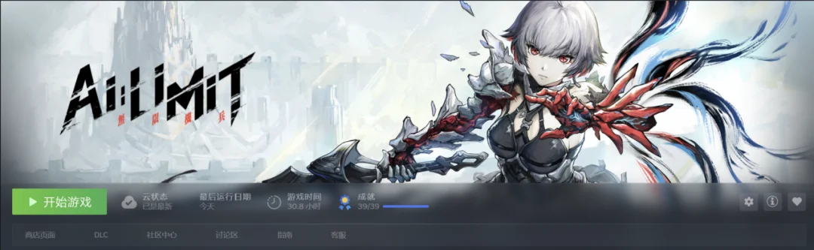
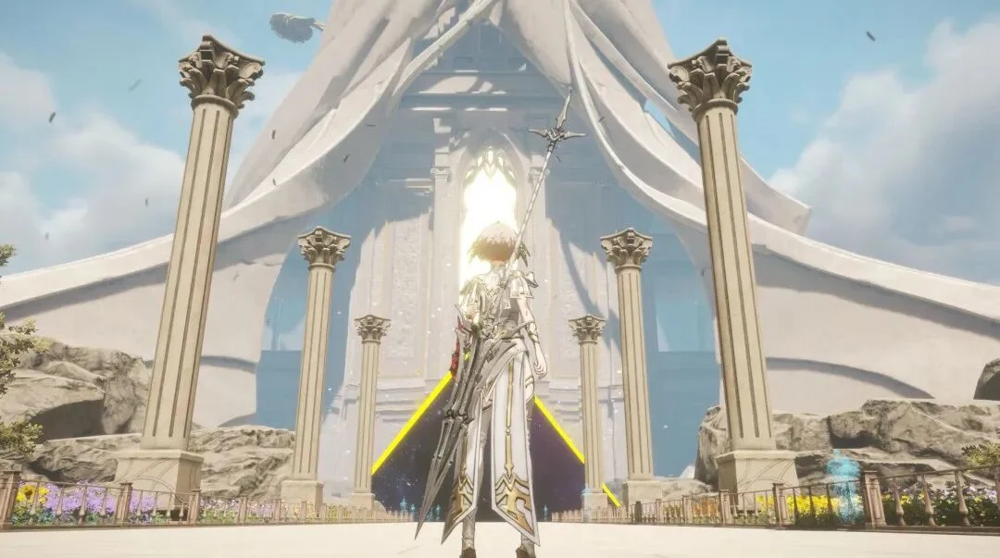
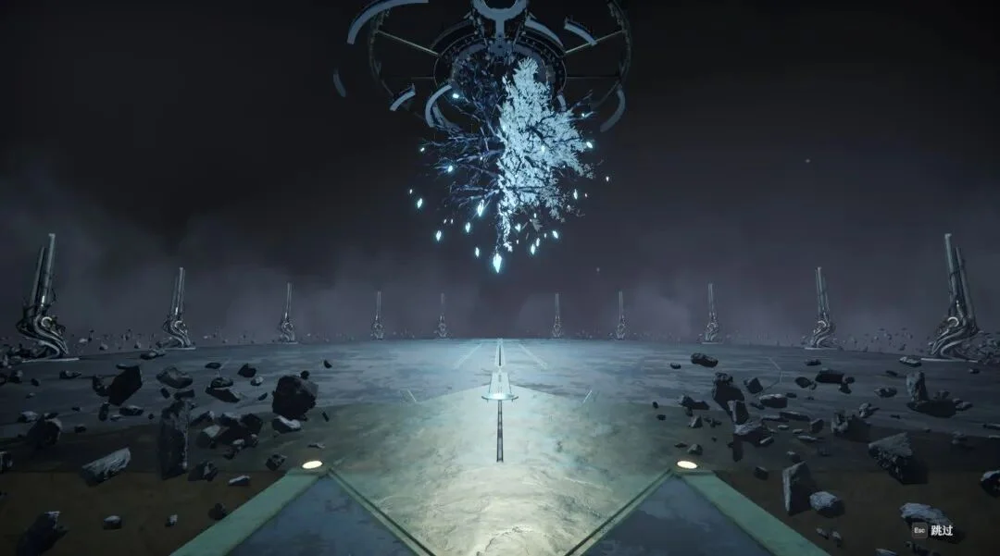
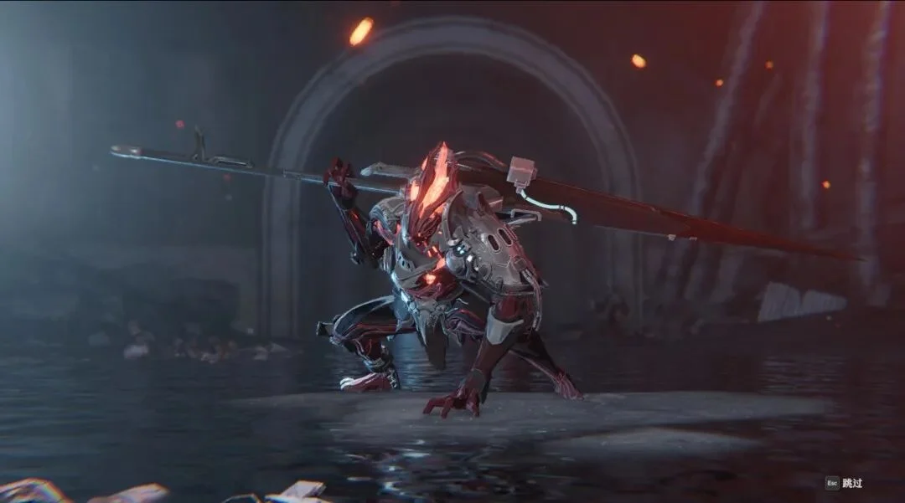
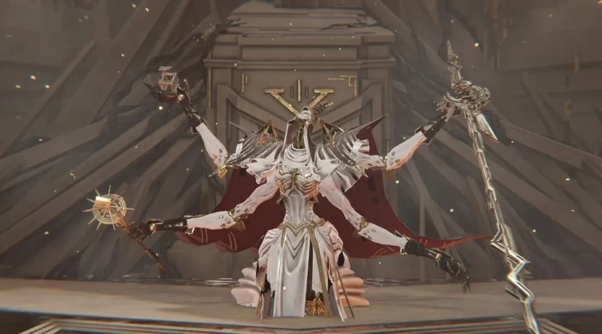
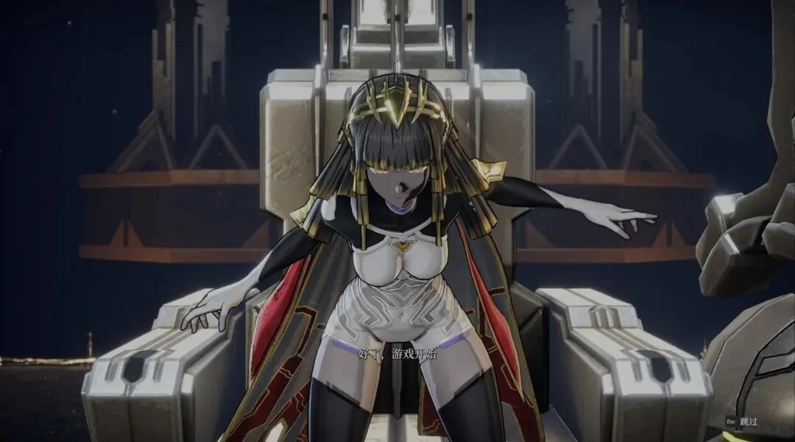
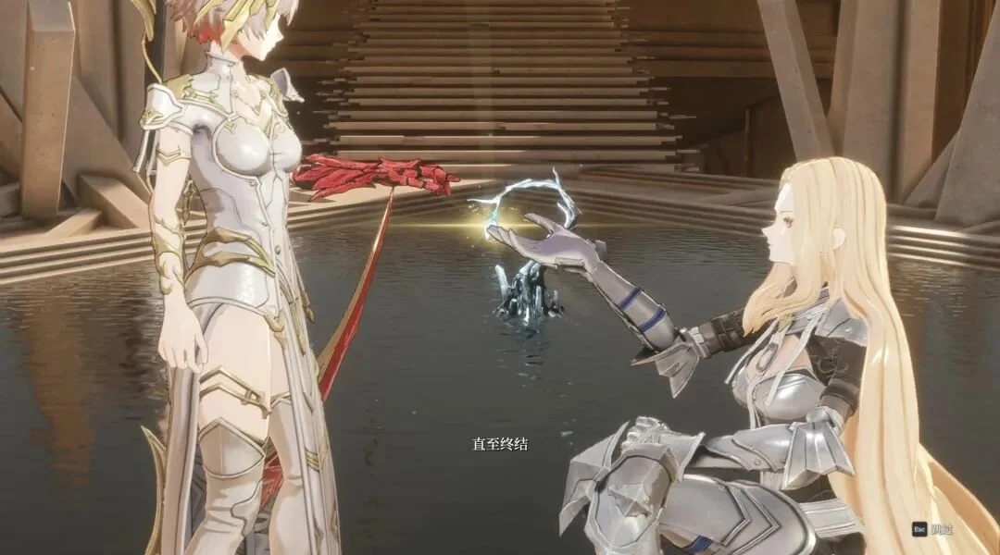
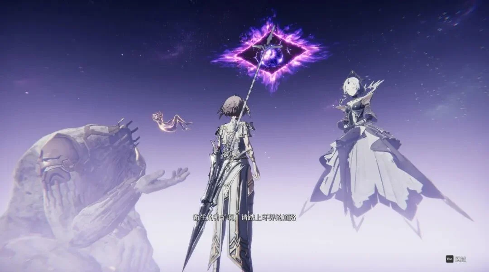

如果记忆被改写、身体源自合成、情感被代码写入，这样的生物算得上人吗？

或者说，人的本质究竟是什么？

《无限机兵AI LIMIT》或许可以带给你一些启示。高大衔接的忙碌之余，涵盖也怀着品鉴之心白金了这款国产类魂。

<figure>
  
</figure>

先说触动最大的美术，突然想起高中课上语文老师说过“作者一定要相信你的读者”，我觉得对于开发者而言亦是如此，一定要相信玩家的审美与探索度，好的东西就是要尽情展示给玩家。在进入大教堂之前，游戏的所有地图都是灰暗压抑的下水道，废楼，枯木林之类，尽管可以说这是后时代末世废土风格云云，可我相信这种风格的地图一定是服务于剧情，起到点缀之用的，如此安排难免略显喧宾夺主。没有人会不喜欢大后期华丽的圣树庭院，震撼人心的无上天顶，以及乌托邦般的净地，只可惜他们藏的太后期了。如果能像初入宁姆格福便可见黄金树，初入伊鲁席尔便可见亚诺尔隆德，让在玩家刚从下水道里摸爬滚打出来后，（不考虑剧情）初入海汶城便看到了高悬的大教堂与圣父，或许整体会更加分。

<figure>
  
</figure>

<figure>
  
</figure>

再说本作最创新的战斗系统。尽管顶着类魂的外壳，本作却舍弃了黑魂标志性的绿条，取而代之的是特色的“同步率”系统，加之各种华丽的战技，术式，框架能力，在战斗上玩起来感觉更像黑猴。优点是玩起来连击不断爽感拉满，缺点是数值难以平衡，导致大前期涵盖甚至说出了“宝宝类魂”这种评价。或许如此设计是作者为了让大家体验各种武器，而且确实在开荒过程中会拿到大量的锻造石，一周目足够升满三把武器，事实是游戏里10+把特殊武器确实是各自身怀绝技，各有特色，当然也都很轮椅（）

地图设计同美术，作者太能藏了。前期下水道贫民窟纯线性地图来的，都快失望时神秘的薄雾森林让人眼前一亮（或许因为致敬老贼传奇法兰粪坑的缘故），后期大教堂上层断层回廊迎来箱庭设计巅峰，两个篝火来回坐撑起了至少一个小时的流程，带给人的惊艳感绝对不亚于幽邃教堂。

<figure>
  
</figure>

<figure>
  
</figure>

音乐貌似比较平平无奇，依旧魂味十足的人声吟唱。唯一震惊的是开场音乐在流程中一直没听到，直到来到真结局boss才恍然大悟，首尾呼应这一块。

说来本作的剧情体验也很奇妙，一周目由于漏掉了一个关键npc的支线，导致大部分主线npc的支线都无法进行，于是我很失望的吐槽主角像一个什么都解决不了只会复读嗯嗯的花瓶。结果二周目过全剧情才发现主角是造物者的完美作品，并且诞生感情与人性对抗各种高等势力，与各种npc对话时正义感满满。恰好对应了好结局与坏结局的主题，貌似是无意中创造了一次独特的涌现叙事，很奇妙的经历。

<figure>
  
</figure>

<figure>
  
</figure>

最后作为国产游戏，不得不表扬一下配音，在略微俗套的剧情里依然能塑造出鲜活的角色形象。血性刚烈的维卡斯，鬼鬼祟祟的斯通，善良坚韧的德尔法，以及在末世里如花般纯洁的雪莉，各种呢喃呐喊绝望哭泣也不做作。主创团队的配音是可以夹带私货的，这些东西外包团队是不一定能做到的。

不谈老头环，《无限机兵AI LIMIT》与“类魂尖子生”的《匹诺曹的谎言Lies of P》也有一定差距。但它在某些方面不输大作的情况下，让涵盖能从游戏中感受到作者创作类魂的决心，创新的勇气和对玩家的照顾，以及小公司创作里资金与档期限制的无奈。无数人在网上因黑猴和影之刃的宏大叙事就妄言国产游戏走起来了，于我而言，这样的小作品才能真正体现出国内市场的活力，未来可期！

<figure>
  
</figure>
