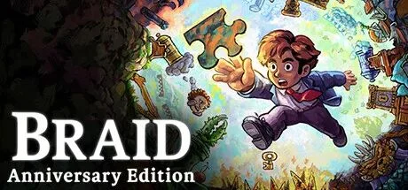
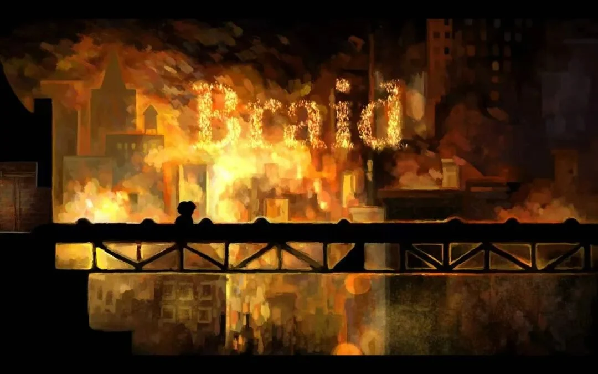
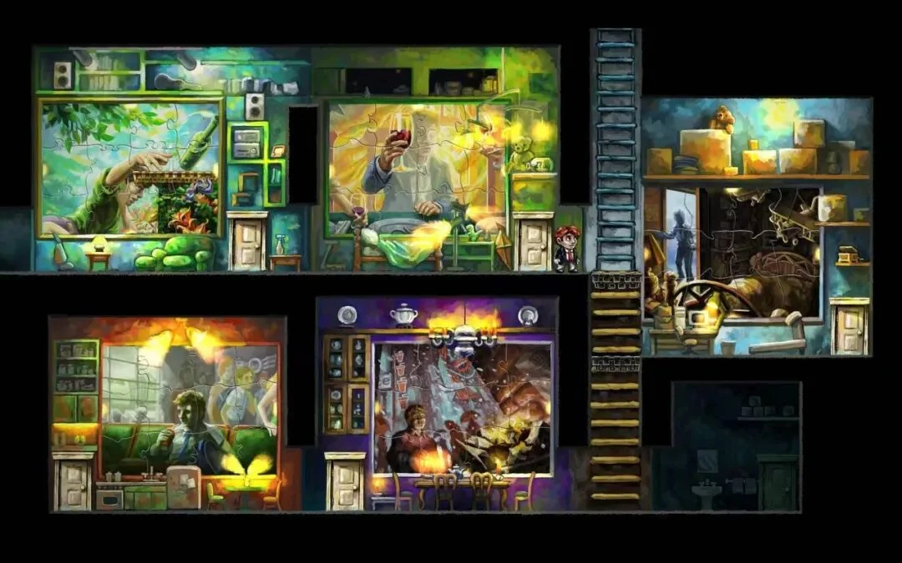
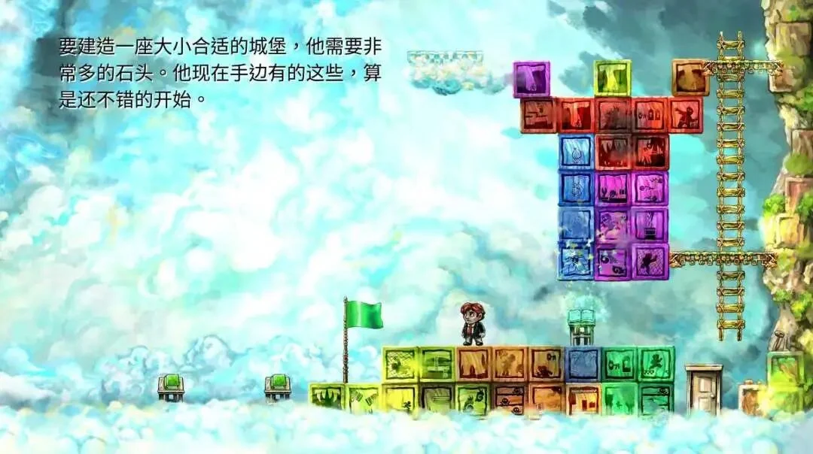
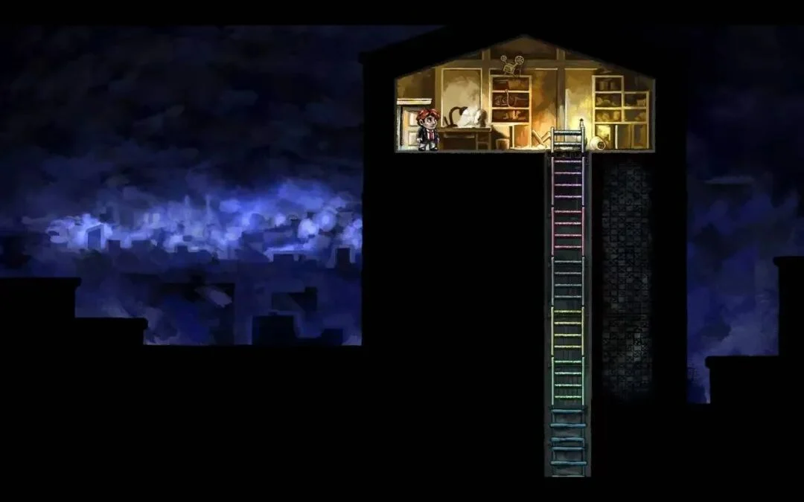
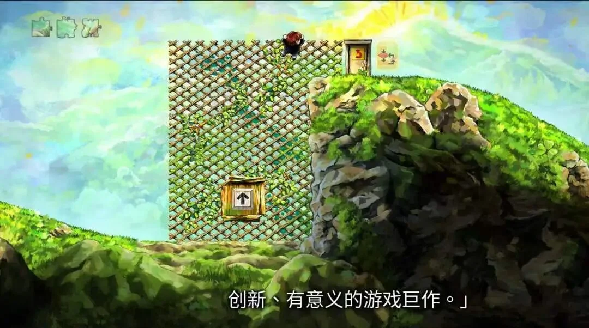

## 时空幻境braid——

*纵在时光之内彷徨，终于回溯之中解惑*

久仰制作人吹哥（Jonathan Blow‌）大名，完全抱着欣赏与学习的态度来品鉴这款大我一岁的游戏，可粗糙的外表根本无法遮掩其深邃的内核，通关之余，涵盖只剩满心感慨，特作此篇评述感怀。

<figure>
  
</figure>

吹哥说：“我的游戏只是指向璀璨星空的一根手指”，诚然，我还没有能力顺着这根手指望向明月与星空，但就像真正的尼采主义者从不会将尼采的话奉为圭臬，我相信吹哥也不会让玩家共识一个标准答案，吸收到自己认可的东西便是意义所在。

<figure>
  
</figure>

从流程设计而言：开局是经典的平台跳跃，刚进入关卡的“世界2”字样令人疑惑。一切的转折点出现在地一次受伤，游戏提示按shift可以回溯时间，自此与标题正式呼应。世界3的不受到六影响的绿光物体，世界4主角的移动控制时间流逝，世界5影子抉择，世界6时停戒指，以及结局世界1的全部倒流，一切围绕着时间展开的机制是那么新奇而独特，放到二十年后的今天仍然不会产生套路化的感觉。迫于上课压力，我尽力耐着性子慢慢品味每个谜题，仍有部分毫无头绪，但并不妨碍其“学习-运用-贯通”的心流设计的正常运行，以至于涵盖之前说的“解谜游戏独有的产生自己是个天才的爽感”仍然可以呈现。

<figure>
  
</figure>

老作不评价美术，但从音乐设计上：bgm的编曲完美契合了游戏核心机制回溯的设计，曲目正放、倒放各有截然不同的情绪，结局浑然一体的倒转旋律，更是暗藏留给玩家的提示。

情节设计上：游历一周后，主角终于回到了世界1，可结合其特殊机制，明明是拯救公主，时间倒流之后的演绎却更像公主在阻碍主角，玩家此时才恍然大悟，原来主角半生蹉跎拯救的公主，到头来还是跟骑士走到了一起。主角望着自己用一路上的苦难搭建的城堡，心中五味杂陈。

<figure>
  
</figure>

最后当然是主题设计：我们总在犯错中成长，可真正的生活一定没有那异想天开的回溯能力，奥本海默在核爆过去几年后说：“现在我们学会了物理学家的罪恶，而这是我们一定不能失去的知识。”主角走过黄沙大漠，呕尽半生心血却与公主失之交臂，他就一定什么都没有得到吗？他看看天上的云，脚下的路，眼前的半座城堡。他确实没有成就任何伟业，可我们与他一起，在一次次回溯中思考了时间，思考了世界，思考了生活。或许主角下一次遇到女孩，再也不必将其视为拯救一切的公主。何为意义？过程本身就是意义

<figure>
  
</figure>

千帆阅尽，余味悠长。我愿在吹哥的另一部倾心之作见证者（The Witness）中，继续探寻独立游戏独有的浪漫，追寻他键盘下那片璀璨星空。

<figure>
  
</figure>
