2026是vibe coding元年，因此也是独立游戏大年，熟练的vibe能极大缩短独立制作者的开发周期。在如雨后春笋般的独游盛宴里，两款增量游戏吸引了我，甚至完整观看了全流程，思绪一下子被拉回了十年前…

## 一、一根吸管和一面墙

首先是《Drink the Ocean》，游戏开场是一根吸管和一整片海。玩家用吸管一点点喝，喝多饱了要跑厕所，后期能更换饮具，也能升级习惯的宽度，尿袋（bushi）的容量等。让人好奇的是那个真的会降下去的海面。最开始吸一口水对海平面下降的作用如同滚木，可等到海平面一点点下降了，就会出现各种有意思的事件和道具。直到喝干了第一片海，露出了一个传送门，供玩家前往第二片海。

<figure>
  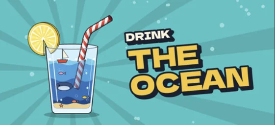
</figure>

<figure>
  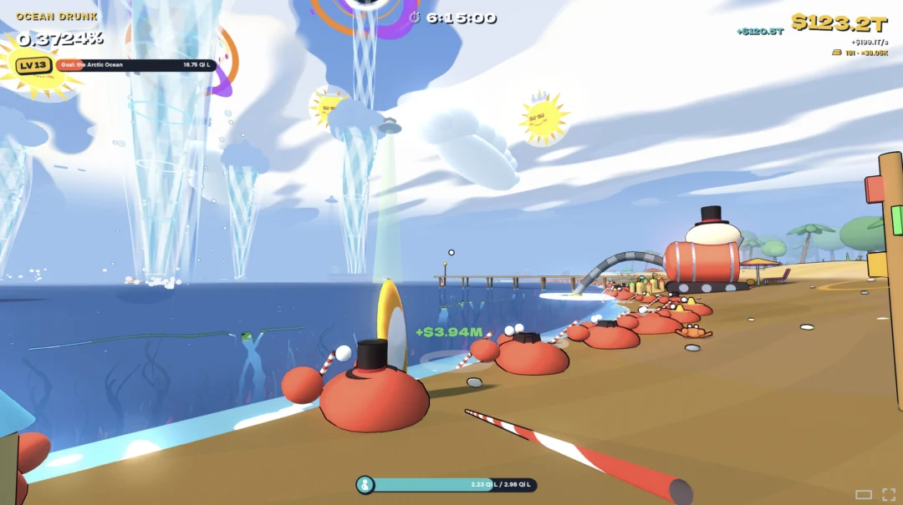
</figure>

另一款是《Punch the Walls》，开始玩家被关在牢房里，先用拳头从墙上打下碎块，再用吸尘器吸收碎块收来换钱，攒够了升级拳头力量速度，吸尘器容量，接着去挖更硬的岩石。监狱外层错综复杂，让人好奇房间外面的房间又有什么。

<figure>
  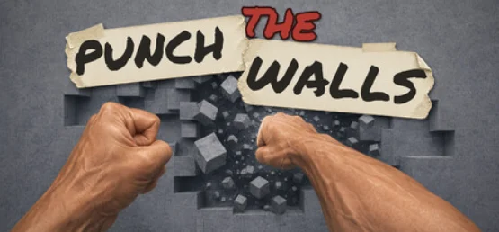
</figure>

<figure>
  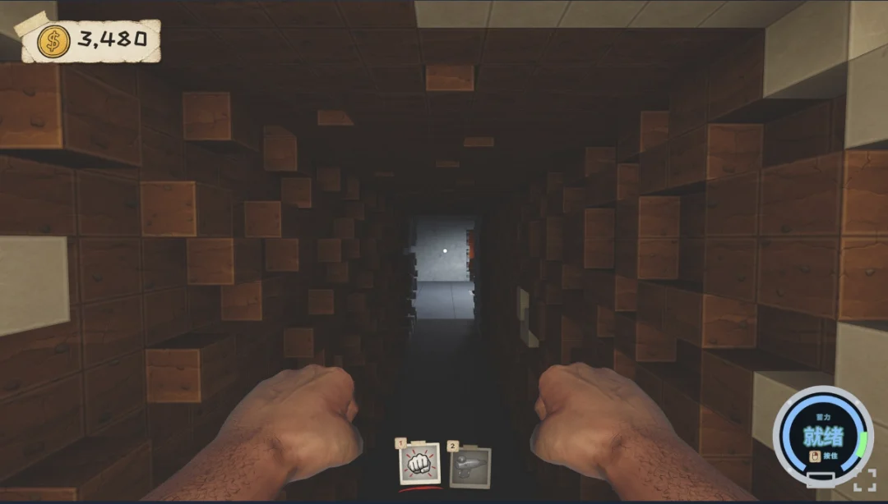
</figure>

## 二、何为增量

所以何为增量玩法？用基础行动攒资源，攒下的资源能投回游戏里升级。一切你能想到让每轮收益变高的增益都可以升级，大致分为点击类升级和放置类升级，前者让手上操作更方便，后者允许手离开以后还有进度。两类升级里又可以分解锁新能力类和提升数值类。加以海量的新地图、新角色、新道具带来的好奇心驱动，似乎增量的玩法就是最纯粹的、最符合人类直觉的、最简单的心流设计。

以及我认为初见最精彩的轮回设计：清空你的所有资源和进度，换取永久性的数值及能力提升。如果把一次轮回看作一次点击，再加上特定轮回次数的奖励，那么增量游戏便达成了一种微观与宏观的呼应。

<figure>
  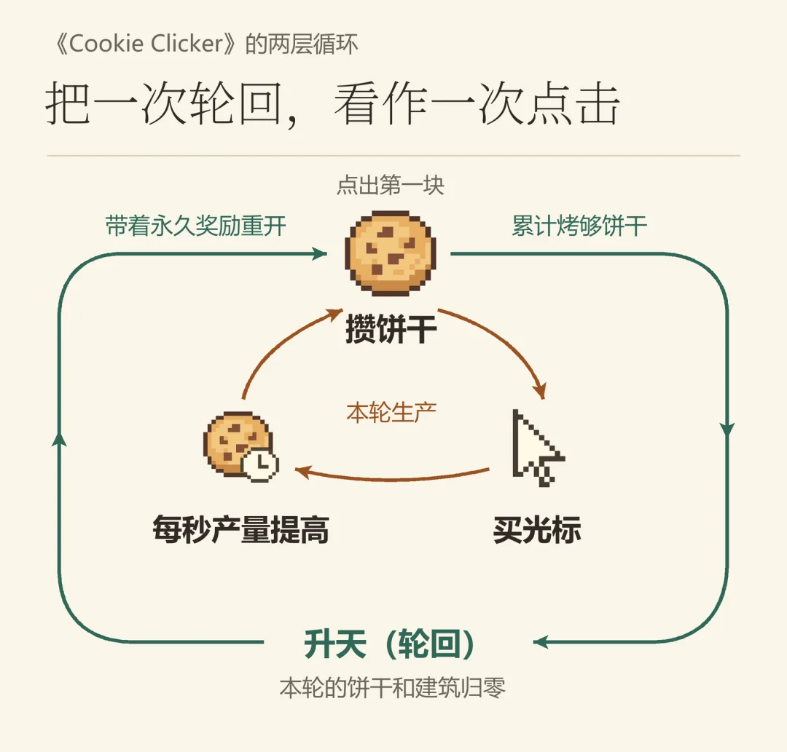
</figure>

## 三、一些曾经

谈及十年前，是因为我记得小学时这类游戏就十分吸引我。微信小程序端《萌犬变变变》，曾经爆火的《点击英雄》，还有老爸手机上一款点青蛙的游戏，名字忘干净了。第一次轮回重启自己的萌犬宇宙是儿时为数不多的心跳加速时刻，在没开智的纯粹日子里，好奇心就是最大的驱动力。

<figure>
  
</figure>

<figure>
  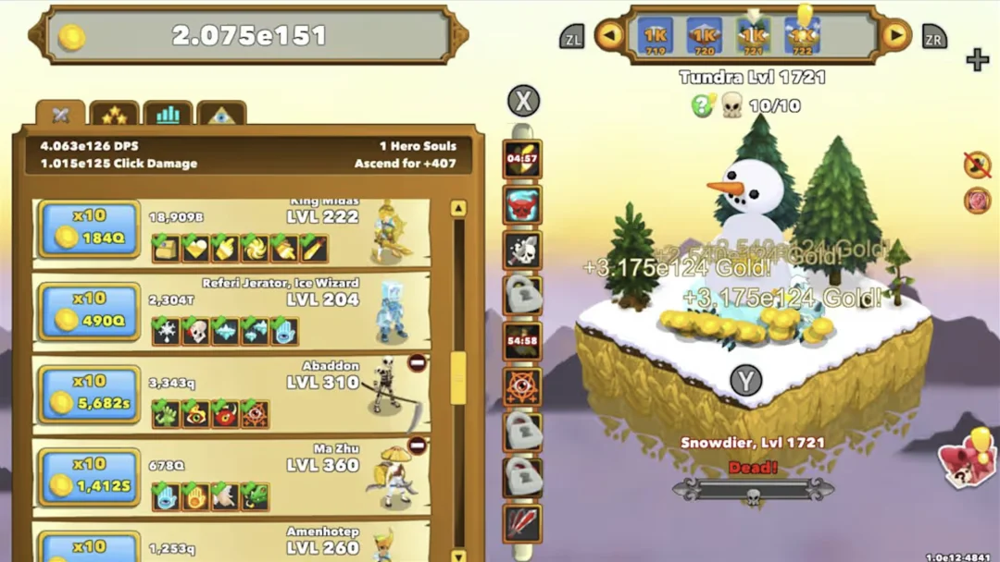
</figure>

我能查到的增量游戏的鼻祖是2002年的《Progress Quest》，第一次以“自动成长”为核心做出了一款RPG。

<figure>
  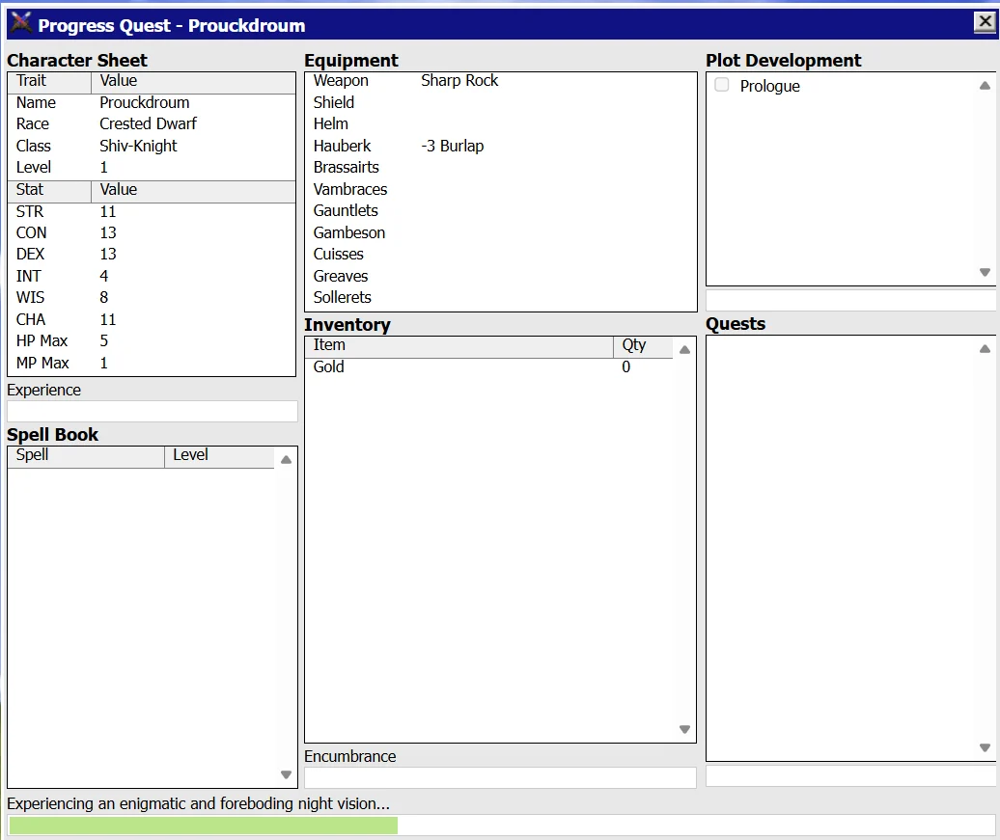
</figure>

后来引起人们关注的是2010年的《Cow Clicker》，作者Ian Bogost 想讽刺 Facebook 上那批社交游戏，把玩法做成了每隔六小时点一次牛，没想到真的有人掐点回来点。

<figure>
  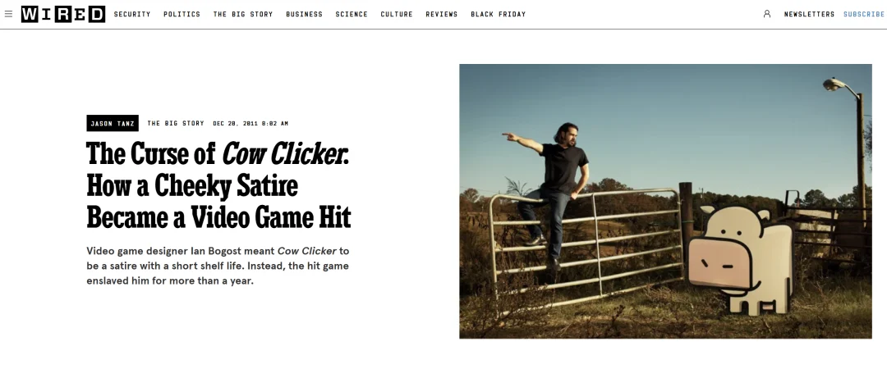
</figure>

后来爆火的是2013 年上线的《Cookie Clicker》，更是从点击曲奇开始，点到大道湮灭，点到宇宙终结（），以至于这款游戏的白金难度十分夸张（甚至还有400多小时流程的白金速通教程）。

<figure>
  
</figure>

<figure>
  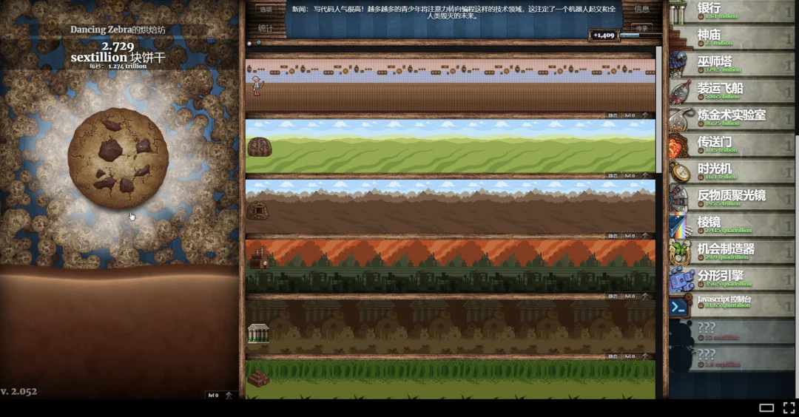
</figure>

还有2021年的《Melvor Idle》，把增量玩法与传统RPG结合，战斗与生活并行，一千余种物品收集，几百张新地图，成为当时打工上学摸鱼游戏的首选。

<figure>
  
</figure>

<figure>
  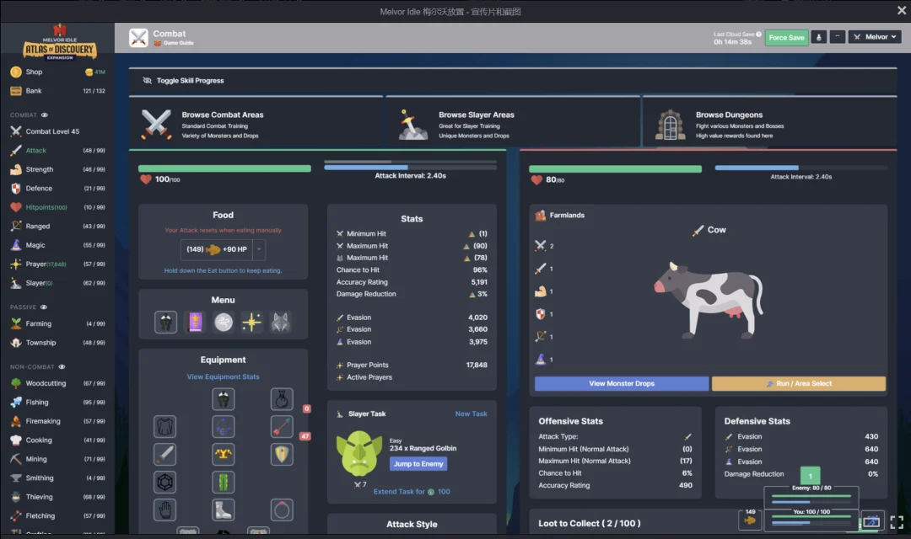
</figure>

## 四、爆火的背后

看到这，有人可能觉得单机玩家简直是一群疯子，能让这么无聊的玩法爆火。但我说，增量游戏的发展本身就蕴含着一些必然。

诞生的必然，源于增量游戏的制作门槛极低。不管是《Progress Quest》还是《Melvor Idle》，他们甚至是网页版起家的游戏。且玩法决定了不需要复杂的美术与画面，省去了独立开发者的一项大开销。如果让我在现在创作自己的第一款练手游戏，我会毫不犹豫地选择增量游戏，不管是手搓还是vibe，增量游戏的框架与制作管线是非常容易安排的。

流行的必然蕴含在玩法本身里。你一定听过“三分钟一局，疯狂水世界，启动！”和“一分钟一局，必须选狙击鸭”，现在的小厂商似乎把快餐化奉为圭臬，但要我说，好玩与快餐化是很难同时做到的。在此给出一个涵盖抽象理论：好玩的底层逻辑就是心流体验，这样的“心流函数”是以时间为自变量的，而“好玩函数”与“心流函数”的极值和一阶导有关。把定义域限制到几分钟以内，就决定了极值很大与一致连续不可能同时发生。

<figure>
  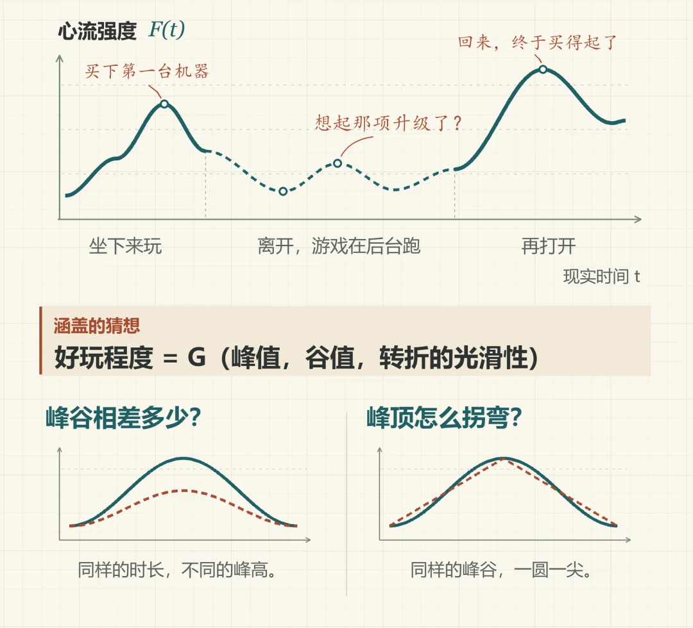
</figure>

于是我觉得，增量玩法便是满足当代人快餐需求的一个可行解。低成本的开始与停止，挂机收益，两大核心特点完美契合不定期的游玩时间与长度，长期游玩之后还有可观的成就感与轮回带来的新鲜感。与其说玩游戏，更像用自己的空闲时间与电脑后台创造了“虚拟价值”。

## 五、尾声

不过，关于增量游戏怎么对应心流函数，我倒有点犯难了。挂机的时候人已经去忙别的了，过一会儿忽然想起来，刚才看中的升级应该攒够了吧？这一小会儿，要不要也算进游戏时间里？

至于那些年到底攒下了多少“虚拟价值”，现在问我，我还真报不出一个数。

老爸手机上那个游戏叫什么都忘了，偏偏记得点的是青蛙。第一次把整个萌犬宇宙清零时的心跳，写到这儿也还能想起来。

十年后我已经会拿高数解释游戏为什么好玩了，可看到有人举着一根吸管站在海边，我还是从头看到了底。

要是小时候的我也坐在旁边，我俩大概谁都舍不得先走。

毕竟，海底下到底有什么呢？

<figure>
  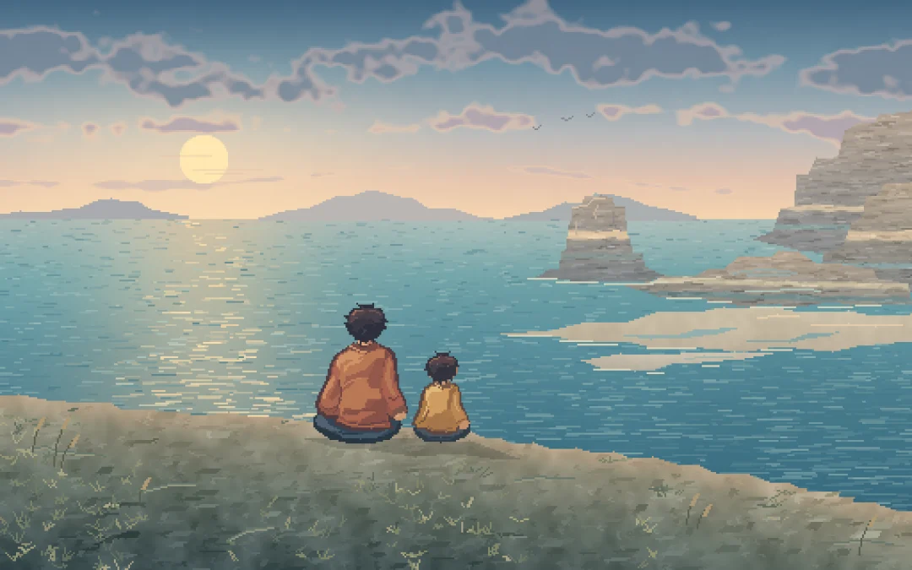
</figure>
