## SANABI

*——第九艺术在线性叙事中的创造力*

当亲身的经历沦为精致的谎言，当费尽心思的复仇成了虚幻的泡影，当发现历经百战的身躯是机器，当昔日的战友沦为今日的敌人，当已故的女儿变成早逝的妻子，当同行的伙伴成了曾经的女儿……

你可能会说，这看起来是一部充满无聊的时空穿越或狗血剧情的游戏，倘若我说，上述的种种转变，是真真实实在主角——甚至说在玩家——身上发生的呢？

这款来自23年的韩国游戏，可能会颠覆每一位玩家对游戏叙事的认识。

久仰《SANABI》（中文译名《闪避刺客》）的大名，涵盖最近也算完整且集中的体验了一番。说来也很奇怪，可能我对好游戏的要求真的不高，刚进游戏意识到仅仅是套着一个典型复仇剧情的、以钩爪为核心的2d动作游戏，我已完全接受了它的热度，因为确实有很多可圈可点的优秀之处。

<figure>
  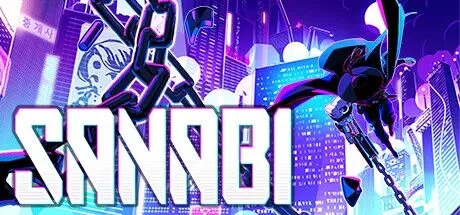
</figure>

首先说钩锁的动作设计，钩锁（也就是主角那条代替右臂的机械义肢“链臂”）作为主角的主武器，一共有三种动作模式，分别为主角提供了径向加速度，切向加速度和攻击能力，虽然在跑图过程中第一种动作模式更加常用，但制作组当然是懂的，所以到了不死鸟（玩家俗称“炎鸟”）的平台战和宋少校（主角当年的部下）一战，切向的冲刺就显得尤为重要了。几乎没有任何数值，仅用三种动作，便设计出了一些很惊艳的boss战，当然会让动作玩家眼前一亮。作者也曾承认：“我在构思故事时，选择的方式是先根据功能性的需求，确定需要什么，然后再往上添加故事……所以像准将的情况，是因为需要他能进行绳索动作……然后才诞生了准将这个角色。”固然是机制先于剧情的。

<figure>
  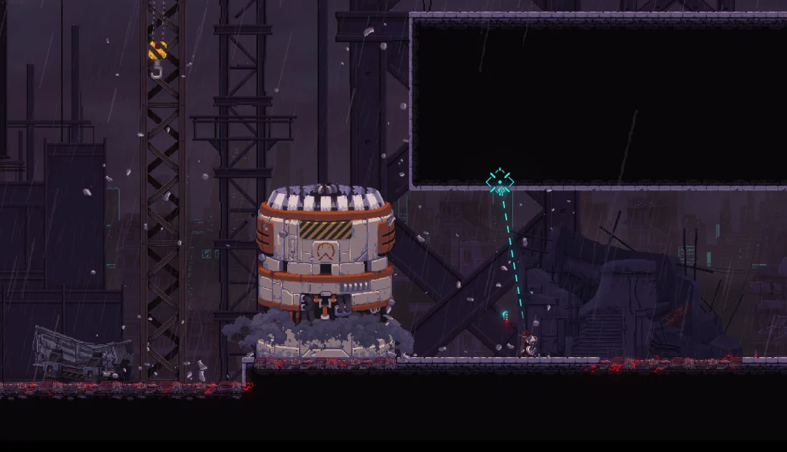
</figure>

其次抓住我眼睛的便是美术。或许是看多了3A的绚丽光影和宏大叙事，好久没吃到这么精致的像素画面，涵盖也是根本抑制不住截图的欲望。

<figure>
  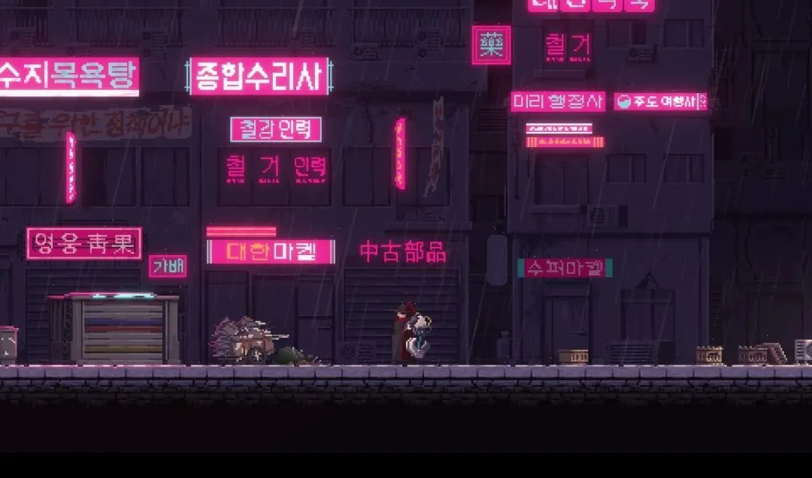
</figure>

<figure>
  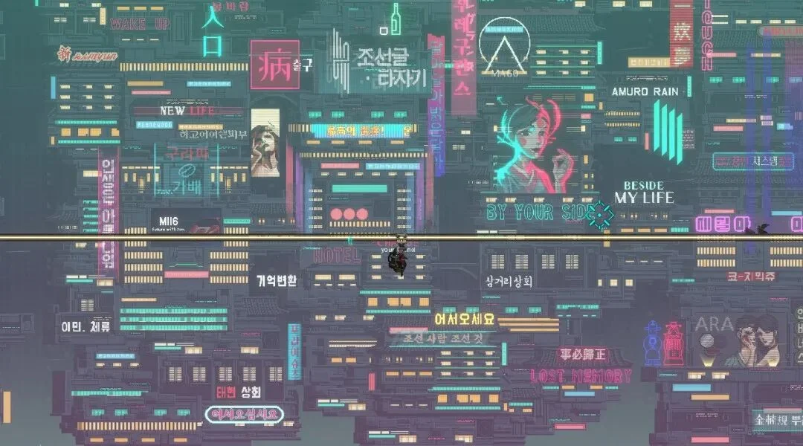
</figure>

当然美术的优秀不仅在于精致的画面，既然本作最大的特色是叙事，美术中自然有独特的语言。比如第三章的监察官，突然以3d的形象闯入2d的像素世界，攻击特效伴随着整个屏幕的抖动变红，不用说就知道他的战力一定是凌驾于主角之上的，果不其然最终仅以一场追逐战结束，这个3d的闯入者最终也没有被完全打败。

<figure>
  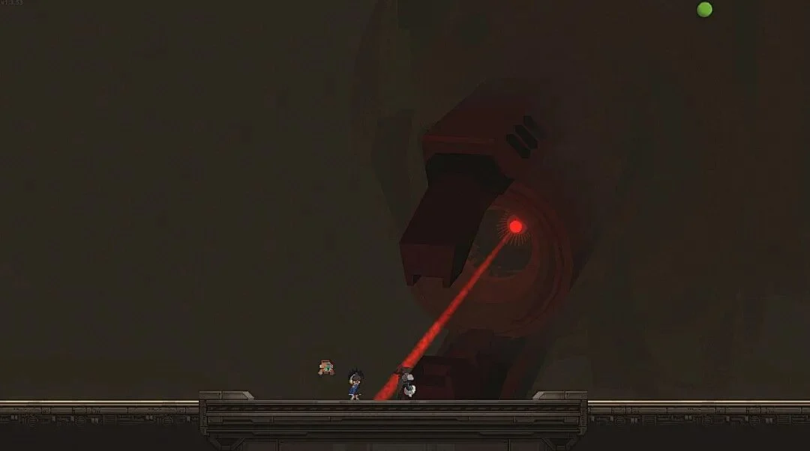
</figure>

再说说一周目我发现的一些非常小但是很拨动人心的叙事细节：本作将文字和对话框用到了很高的水平，这也确实是像素风格中最有力的表现人物情绪的办法，文字的变红，变大，抖动都是语言之外的语言。同时本作的音效组也下足了功夫，譬如伴随对话框与文字落地的音效，譬如特定剧情戛然而止的音效，譬如追逐战中随boss距离变化的音效，说出来都是一些很小的事，但只有真正在游玩的过程中才知道这些设计有多么自然，多么巧妙。

<figure>
  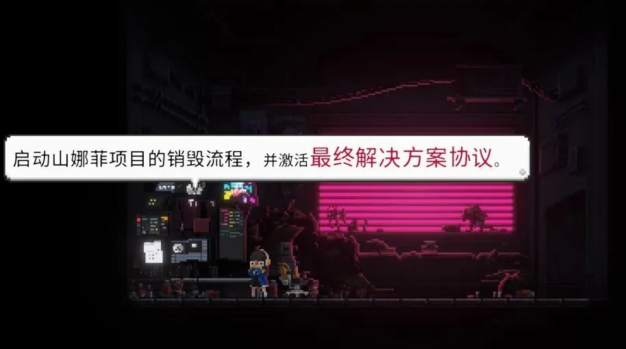
</figure>

现在让我们开始正文：对游戏情节结构的介绍。

（以下内容力求让没玩过的人能听懂，但难免涉及剧透，如果有兴趣自己玩的玩家酌情观看）

## 一、线性叙事的二次往复

游戏里的麻古市是一座垂直的城市，主角要从最底层一层层往上爬，而游戏本身也分成几章。由于主角的记忆曾被打乱，因此在第五章掉到城市底部前后，很自然的形成了两遍的线性叙事：第一次是游戏表面想营造的“退役准将向夺走爱女的恐怖组织复仇的赛博朋克动作剧”；等到记忆恢复、真相揭开，他第二次爬上城市顶端时，同样的路变成了另一回事，这时真相才浮出水面：原来是“‘父亲早已不在，女儿用他的遗物人格数据把他做成机器人，只为让他再陪自己走完最后一段路’的家庭悲剧”。

<figure>
  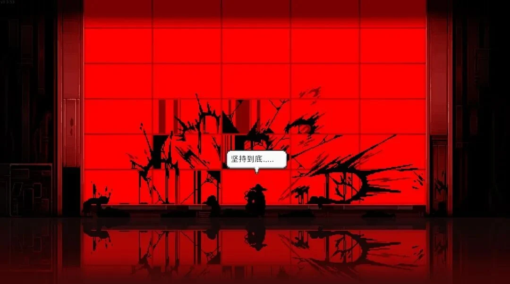
</figure>

<figure>
  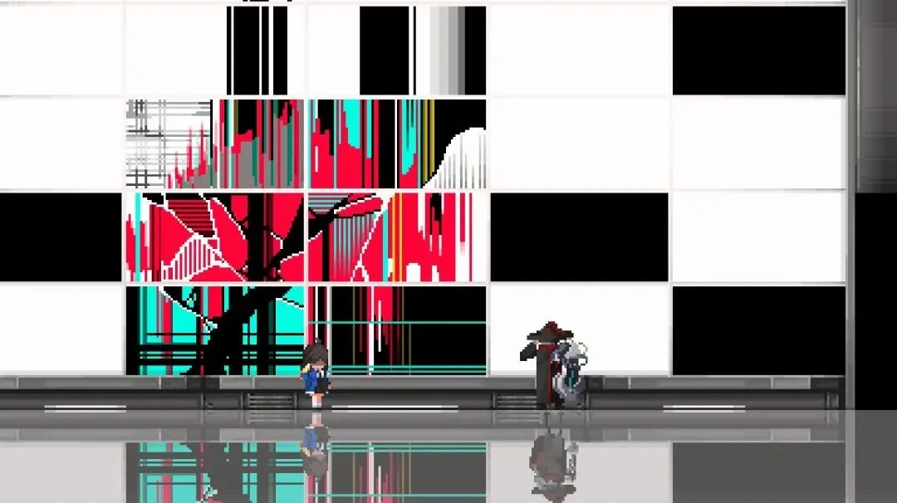
</figure>

ps：在两遍线性流程中不变的最典型的就是象征强权与财富的“麻古集团”，意识到作者是韩国人并将故事背景设定在朝鲜后看的我也是津津有味（）

## 二、三层反转与三个叙事工具

反转是文学中常用的手法，但SANABI中的反转是一种让你重构先前对剧情所有认知的反转。这三个反转在我开头也部分提及：

- 死的不是女儿，是妻子（记忆篡改）；
- 主角不是人，而是搭载他人格数据的机器人17287（游戏里编号17287的“沃克”，也正是玩家全程操纵的那具身体）；
- SANABI 不是仇人，是家族纽带（母亲留下的口琴曲）；

特别是最后的SANABI反转令人震惊，玩家在全流程95%的时间里都不知道这个词的具体含义，完完全全是一个抽象的概念。

<figure>
  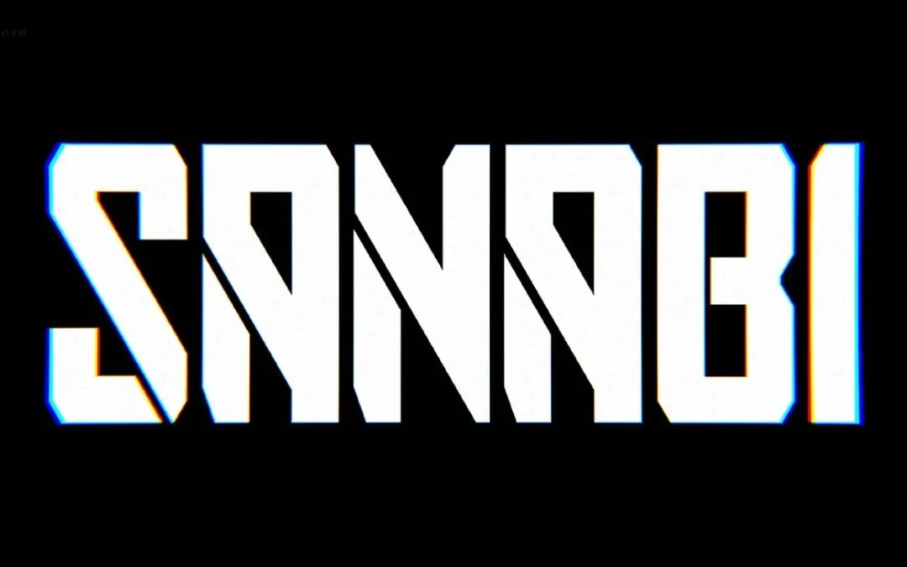
</figure>

而三个叙事工具是指三个游戏中的设定，分别是：

1. 噪音过滤：指机器人形态的主角被敌人植入的过滤程序——凡触及真相的台词（“大叔你是■■■”）在主角听来是噪音
2. 认知滤网：同样是主角被敌人安装的硬件——他看不见人，于是“297 万人蒸发”这个巨大荒谬覆盖了一切小矛盾，直到玛莉（与主角同行的少女）问出“看得见了吗？”满地尸体凭空出现。
3. 戏剧性反讽：指主角因缺失记忆及情节而不懂玛莉的部分作为，玛莉每次呕吐、每次问“你看不见吗”、每次固执地递口琴、每次用图片讲作战，玩家都是事后才明白那是女儿在向父亲示爱。

<figure>
  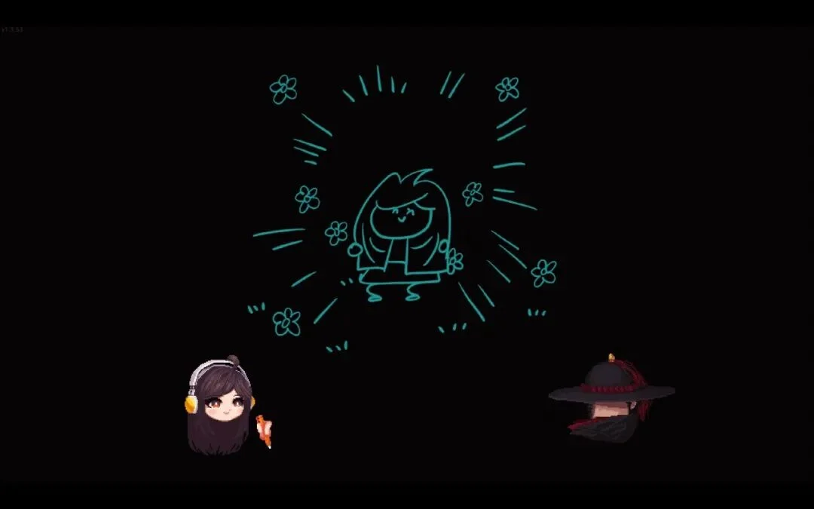
</figure>

<figure>
  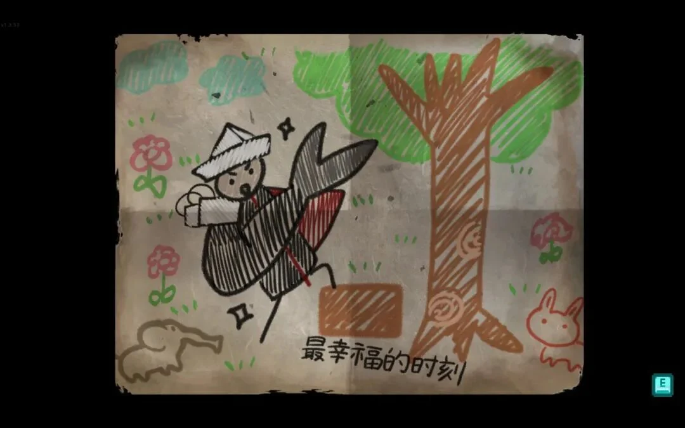
</figure>

## 三、明暗双线叙事与多处交汇

本作同时在讲“复仇剧”和“告别旅行”。那位一路与主角同行的少女玛莉，其实正是他的女儿：她把童年清单里的大城堡、蚯蚓人、英雄合影、打不过的怪物、天上飞的列车一一对应成四章 Boss——玩家以为在推进复仇，其实是在参观一个孩子写在纸上的愿望清单。而上文提到的口琴，手绘画都是让两条线产生交点的关键道具。两条线在结尾时也完成了交汇。

<figure>
  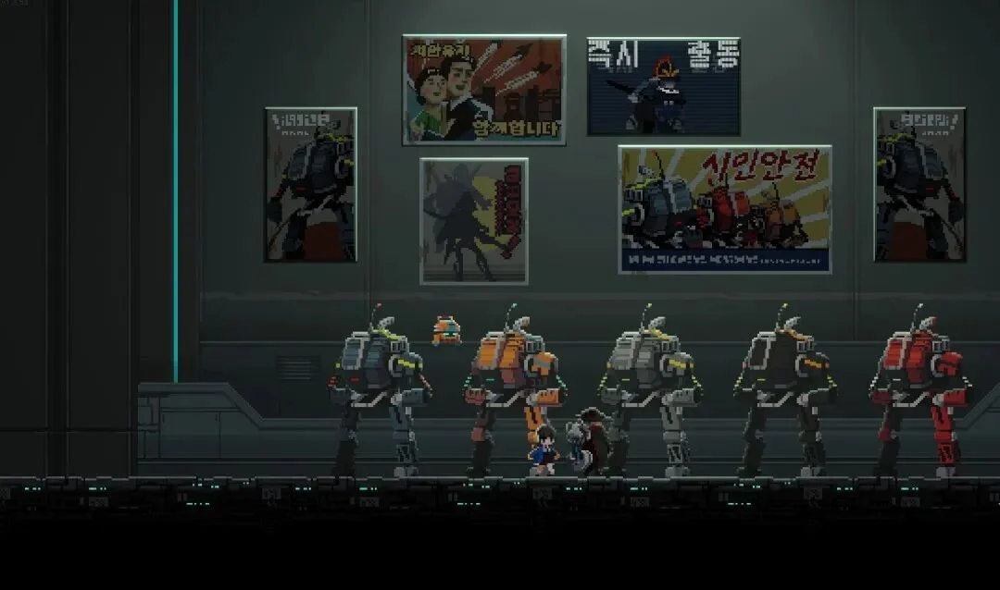
</figure>

<figure>
  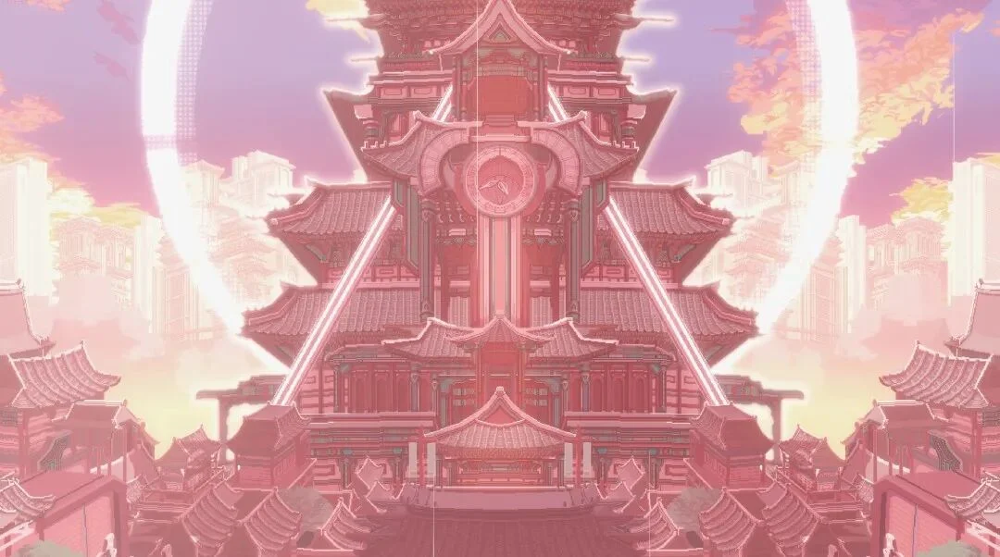
</figure>

<figure>
  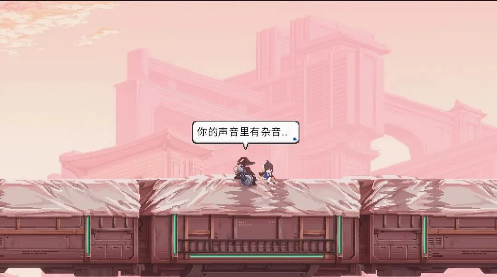
</figure>

## 四、玩家与主角的完全融入

这是本作最令我震撼的地方。导演本人曾强调过：“比起故事本身，如何将故事传递给玩家更为重要。”而他的这一次演出，一定开创了一种让剧情深入玩家心中的方式。

比如“噪音过滤”让玩家和主角同时被夺走听觉，比如“认知滤网”也让玩家跟着接受了“297 万人蒸发”这个巨大荒谬，玩家与主角的信息永远是同步且对等的，导演没有给主角起名也正是为了增强代入感，所以最终真相揭晓时，主角有多崩溃，玩家就有多震撼。

<figure>
  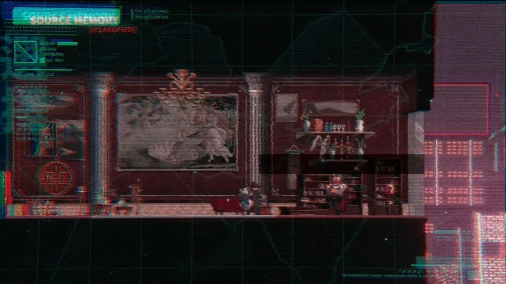
</figure>

而且关于游戏中最大的伏笔口琴曲SANABI，甚至可以说口琴的真正作用是把玩家和角色一起"改写"：打开游戏的那一刻，标题界面播放的就是《SANABI》；随后几十首配乐几乎都在变奏这条主旋律。因此——玛莉把"SANABI"扎根进主角的虚拟人格，游戏把"SANABI"扎根进玩家的潜意识，两者用的是同一手法、同一段旋律。于是真结局主角拿起口琴吹响它时：这段旋律对玩家来说是"第一次听到的口琴"，却又是"已经听过无数遍的旋律"——主角想起这段旋律的瞬间，就是玩家想起这段旋律的瞬间。

玩家从游戏一开始就已经知道 SANABI 是什么了，玩家却到最后才知道SANABI是什么。

<figure>
  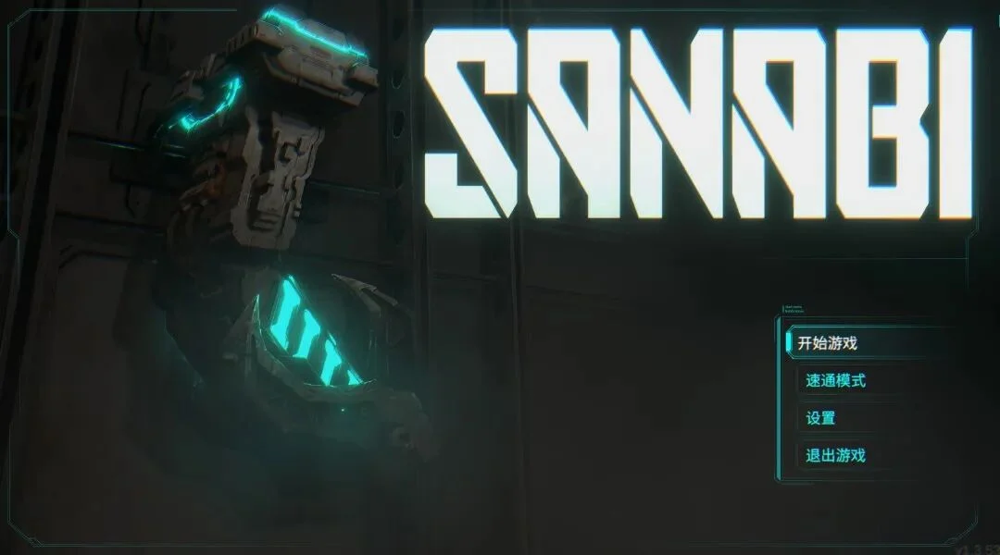
</figure>

<figure>
  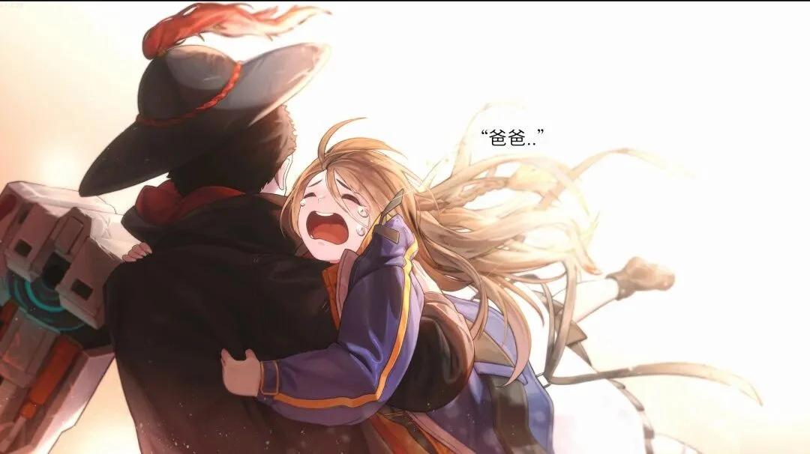
</figure>

基于以上赞赏与讨论，不得不遗憾的一点是，中文外包组将游戏名翻译为《闪避刺客》，将游戏中的SANABI音译为了“山娜菲”，失去了原作叙事的一部分效果。导演本人有一句恰当的自述：“或许是基于此玩法，游戏的中文名被意译为《闪避刺客》。然而就玩家的实际体验而言，初始标题 SANABI 或许才更契合游戏的剧情”

如果你看到了这里，你一定对本作甚至强叙事的单机游戏产生了一些兴趣。为什么电子游戏可以被冠以“第九艺术”，我想SANABI就给出了最好的解答：全方位、立体化、强交互、不同于传统文学的叙事，正是其成为艺术的理由。

<figure>
  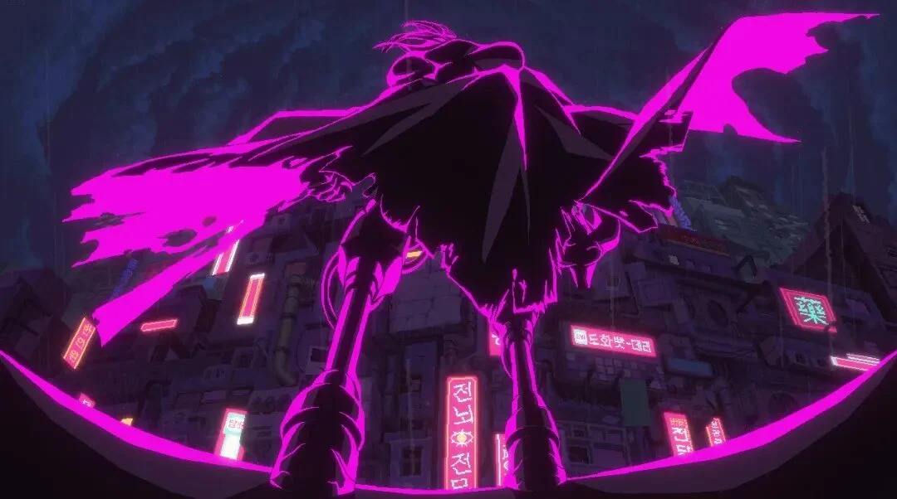
</figure>

## 参考资料：

[1] 姜惠珍. 文学到游戏的转变之解读代码：伏笔与空间——以游戏《SANABI》中的“巴里”为中心[J]. 古典与解释, 2025(47): 119-153.

[2] 金贤淑. 线性与分支叙事结构中的玩家依附比较：《SANABI》与《底特律：成为人类》[J]. 韩国内容学会论文集, 2026, 26(5): 147-156.
