## 序——我与吹哥的第二次邂逅

我曾不止一次在先前的《COCOON》和《Braid》朋友圈和文章里提到“解谜游戏需要一种觉得自己是天才的爽感”，在20+小时的《The Witness》（见证者）沉浸体验之后，涵盖的这句话在吹哥的心血之作里找到了它的终点。

<figure>
  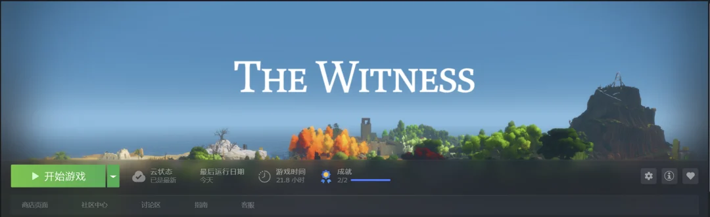
</figure>

替身使者会相互吸引，或许热爱游戏的灵魂，无需沟通就能产生遥远的共鸣。

《独立游戏大电影》中有三位作者（《时空幻境》《超级食肉男孩》《FEZ》的开发者）：当我在《以撒的结合》通关里世界后看到了宗教与牺牲，我明白了E胖能成功是因为他的专注表达而不迎合市场；当我在《FEZ》中收集了32个立方体（Cube）才发现还有32个反立方体（AntiCube），我明白了鱼哥能成功是因为他的放荡不羁和独立思考；而当我在《时空幻境》（Braid）中惊讶于各种回溯，在《见证者》中频频顿悟，我才明白吹哥的成功是最纯粹的：一种对哲学思考与艺术表达的执着，与一颗虔诚的热爱游戏的心。

<figure>
  
</figure>

考虑良久，我决定不把这些文字投到测评区，因为我散乱的思绪仍不足以完全找到吹哥的星空。一晃才发觉这已经是十年前的神作了，或许把这些串联旧游的思考放到朝花夕拾区更为妥当。

## 一、基本介绍

《The Witness》是一个把“教学”彻底从文本里抽出来、用关卡顺序本身来教学的游戏：它不解释、不提示、不手把手，只负责把“从不懂到懂”的那一下反复交到你手里。这就是我开头所述“解谜游戏需要一种觉得自己是天才的爽感”。

吹哥在访谈中的原话是这样的：

> 「这个游戏在主题上是关于清晰（clarity）的，关于清楚地理解世界。……在设计里，我只是想给玩家机会；你没法强迫别人获得某种体验。」

> 「它很难用语言表达——那是某种非语言沟通的东西，是自由地探索这个世界，然后一次又一次地从“不懂”走向“懂”的那种顿悟体验，反反复复。」

在这里以开场的一小段为例，感受一下“第九艺术”的独特语言：

开场是整部游戏教学的样本：醒来只有一条路，划开门上的线 → 出现L形线，再划 → 见到一块有圆点与半圆的板子，从圆点画到半圆即通。三块板、零句话，玩家已经学会了“一笔画”的全部基本语法。

<figure>
  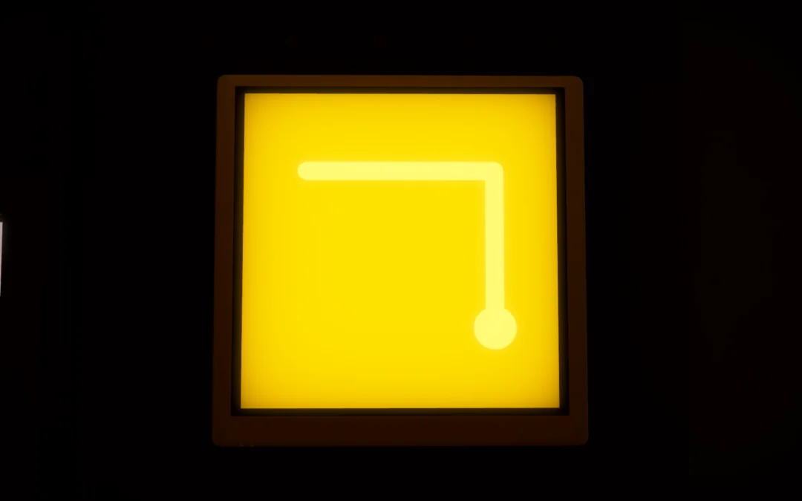
</figure>

通关音效与发光的线管承担了“往哪走”的指引——用环境代替UI提示。

接下来几块板子依次教：起点可以不止一个、终点也可以不止一个，并埋下“线可以接到板外”的暗示。

<figure>
  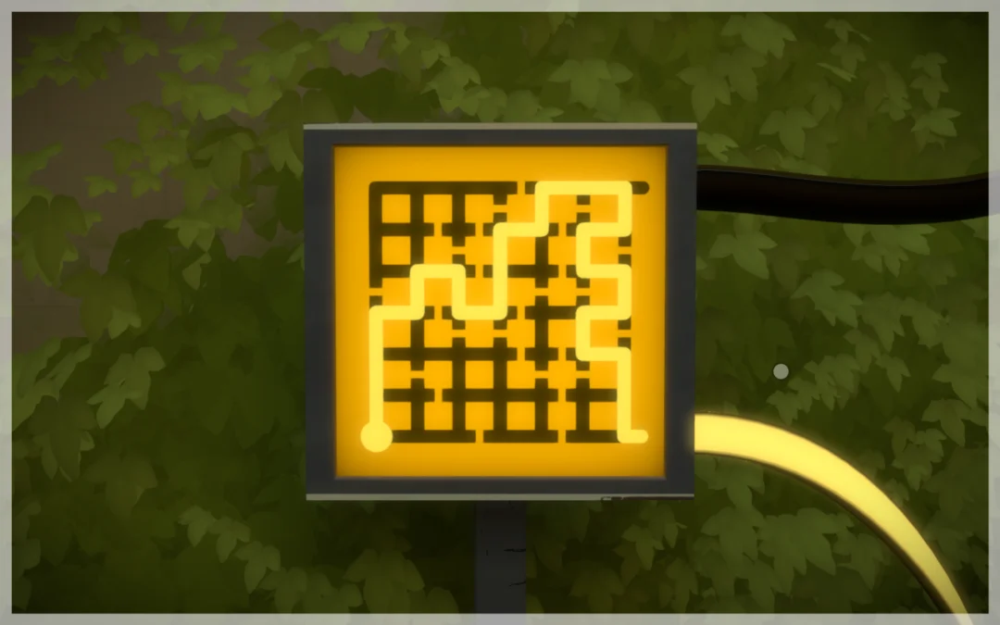
</figure>

出门后玩家会遇到一块“上面有两种此刻还不认识的东西”的大板——它是故意解不开的。它的作用是告诉玩家：“见到不懂的东西就先绕开，你会在别处学到它。”这条规则是全岛最重要的元规则。

<figure>
  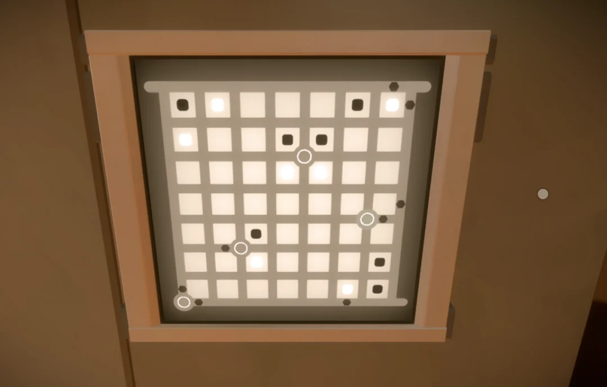
</figure>

访谈中有诸多像上述设计理念的介绍。这一次游玩《见证者》，我是零剧透零攻略的纯净式体验，看过访谈之后，我可以保证地说，吹哥的每一个小巧思都被我精准地踩到了。

## 二、关于顿悟（epiphany）

吹哥把“反复的顿悟”视为游戏的核心体验：

> 「……having this experience of epiphany over and over where you go from not understanding to understanding, repeated over and over.」

（大意：一次又一次地经历顿悟——从不懂到懂，反反复复。）

他承认自己无法确切控制这种体验，只能通过准则“提高它发生的概率”：

> 「一个常见现象是人们经常卡在游戏某处……然后他们稍作离开，去处理日常事务或者去睡一觉，结果到了第二天早晨，他们突然间搞懂了谜题的解法。……作为设计者，我奉行一些准则来鼓励这种体验发生的可能性。」

关于第二句话我深有体会，因为我实实在在地在一个谜题上经历了这一切。迫于早八压力，我卡关心急也只能睡觉，洗漱过后躺在床上双眼微闭，脑子里却都是谜题，睡不着，最后真想了出来，并在想象里验证了好几遍，第二天起床第一件事就是打开电脑完成它。回想卡关的原因也很简单，只是犯了做平面几何时犯过无数次的错误——思维惯性，不知道是不是吹哥有意为之。

<figure>
  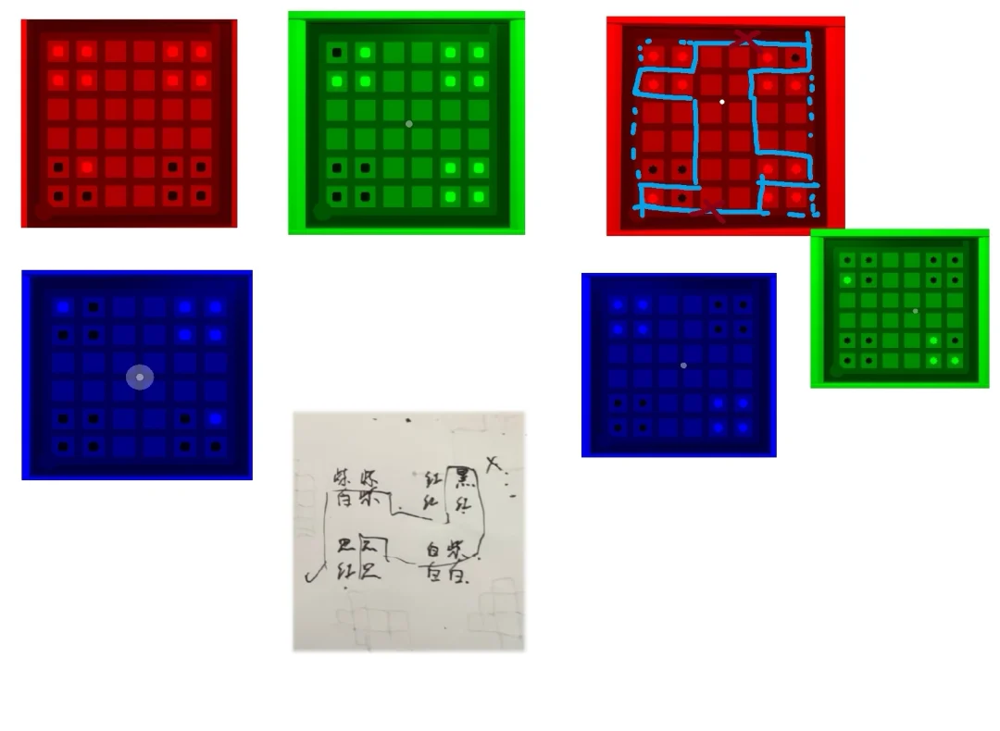
  <figcaption>卡了涵盖一晚上的颜色叠加谜题</figcaption>
</figure>

而上文所说“反复的顿悟”，确确实实地贯穿了整个游戏。如果说流程中的解谜让我顿悟，我充其量称吹哥是一位富有创造力的游戏设计师。但当我意识到黑色石柱上对应着135个环境谜题时，我真正明白了吹哥是一位彻彻底底的艺术家。放两个我自己发现的，震撼一下……

<figure>
  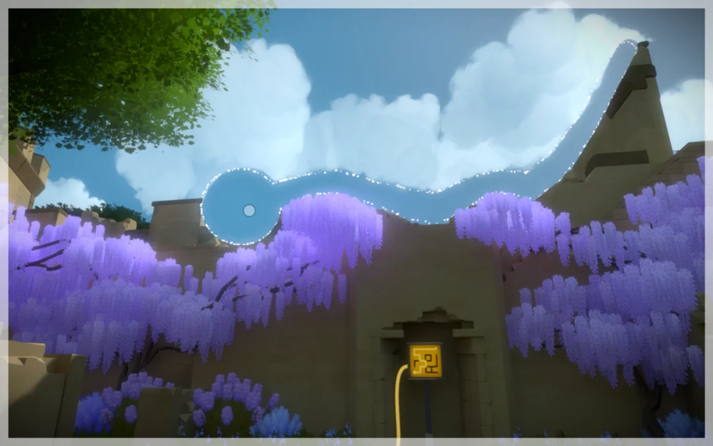
</figure>

<figure>
  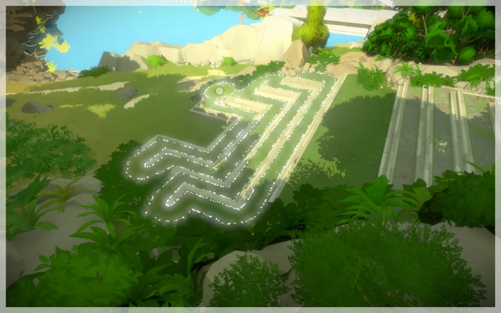
</figure>

<figure>
  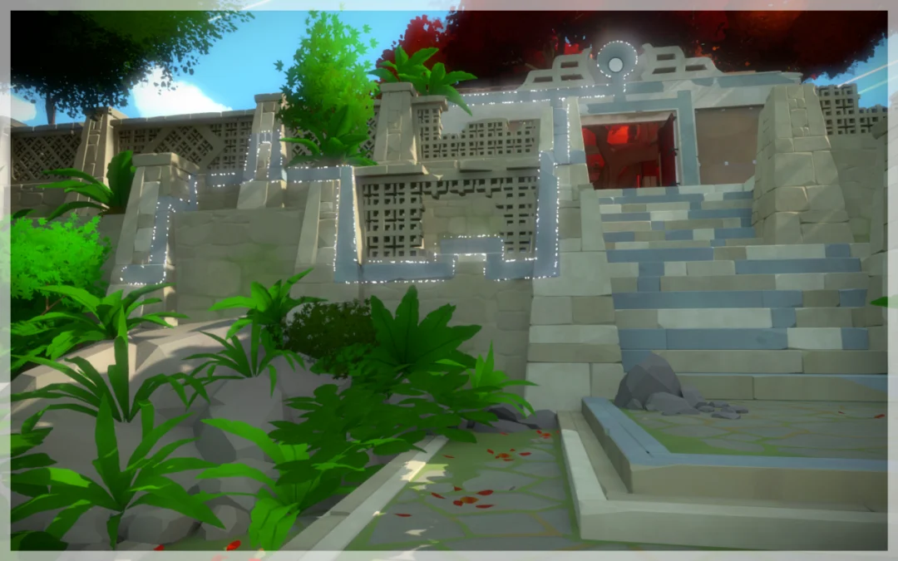
</figure>

这些谜题虽然与成就无关，但我大概也不会去看攻略了，因为在通关两周后，我还是偶尔会到小岛上转转，欣赏风景的同时说不定也会找到两个环境谜题。

## 三、几个印象深刻的区域

### 樱花林

这是游戏里的一片非主线区域（以至于我解开所有谜题后笔记里还躺着一句“找不到的粉线”），也是第一个让我惊艳的地方。放一张图片在这里，各位自然会理解。

<figure>
  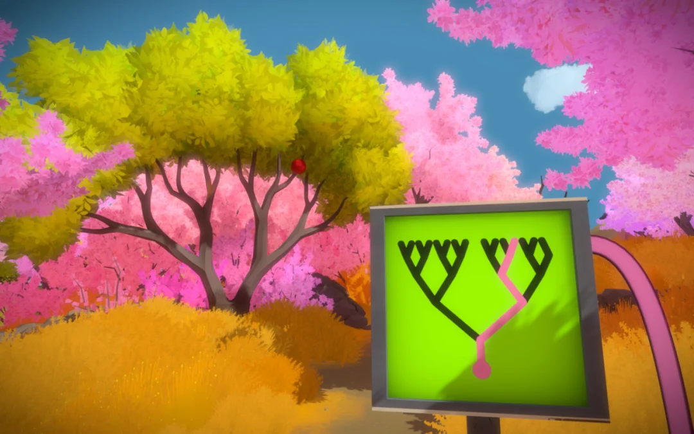
</figure>

是的，在一个连线解谜游戏里，第一次出现了谜底不在板面上的情况，这片区域也为后续很多区域提供了一个重要的视角——利用周围环境。后来了解到，这片区域的奖励就是我最后所能找到的一间工作室，里面有一些盆栽、一盘苹果片，以及人体心血管系统的示意图。这些物品充满了象征意义，暗示着游戏更深层的主题——关于连接、生命与认知。

<figure>
  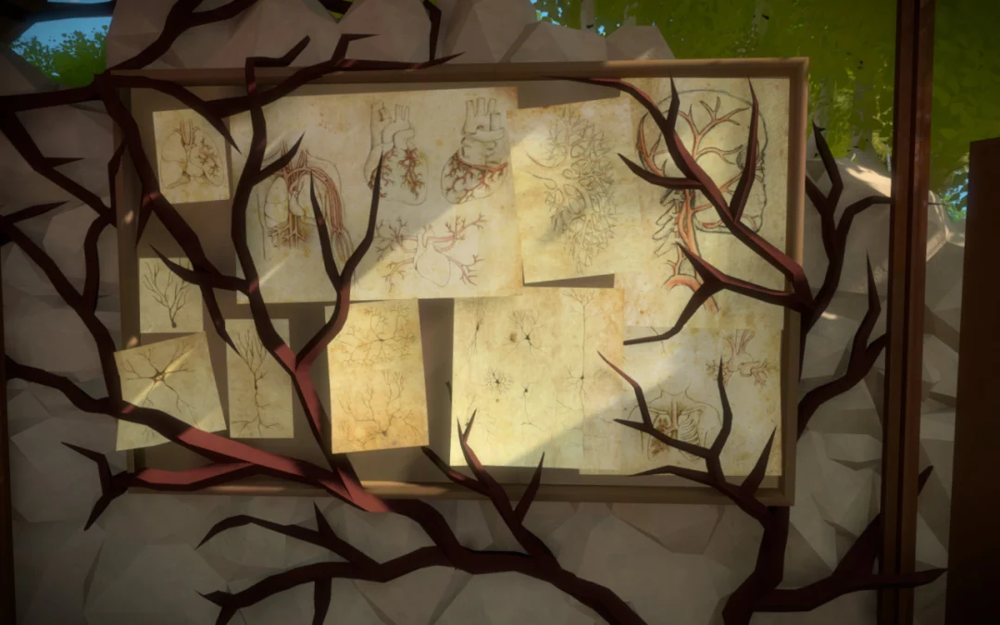
</figure>

### 沙漠神殿

这是游戏里第一次让我长考过后放弃的区域，本以为是缺少了需要学习的规则，完成了许多其他区域后依然没有类似的形状。其实卡关的本质是我不够相信吹哥，不够相信“答案一定在区域里”。当我充分相信这件事时，我看这神殿上的太阳，从光影中找到了答案：解谜面板上有可以反光的划痕。有了光这一关键提示，后面的折射反射之类也就信手拈来了。

<figure>
  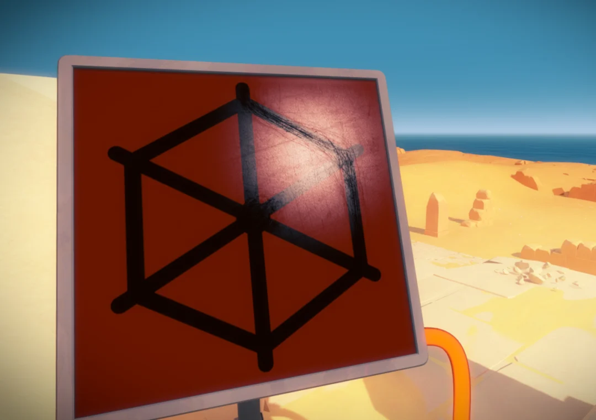
  <figcaption>阳光下面板上的划痕</figcaption>
</figure>

很经典的“当你解决不了问题的时候，可以离开去尝试先解决其他问题”。

### 城堡迷宫

这个区域很有意思，需要你完成迷宫并把走过的路线呈现到解谜面板上。只不过迷宫的形式会越来越抽象，最夸张的是需要听走在地上声音的不同去判断哪里是路哪里是墙，若不是《FEZ》中给过我声音解谜的思路，在这里或许真的要看攻略了。这么巧妙的设计果然在另一个区域里复现，一个完全需要听声音来连线的区域。而完成四个小迷宫走到了城堡的顶上，看到下方拼在一起的巨大迷宫和眼前的巨大面板，不禁会心一笑，突然就体会到了《Patrick's Parabox》带给我的迭代思考与自指思考。

<figure>
  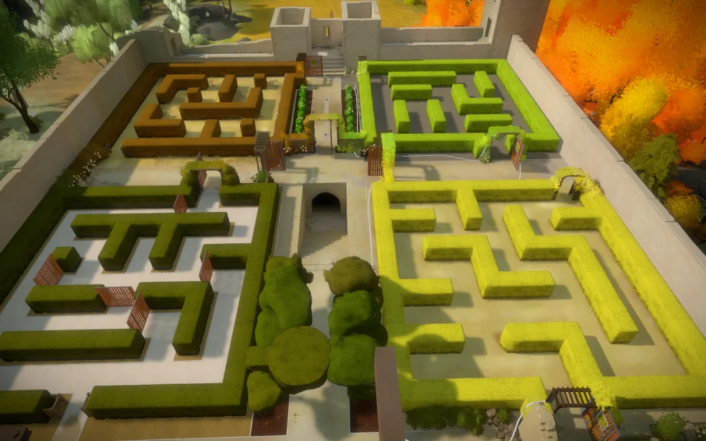
</figure>

<figure>
  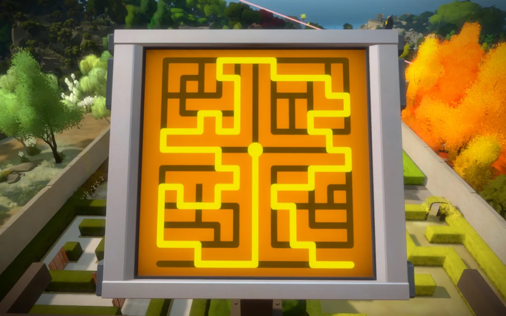
</figure>

<figure>
  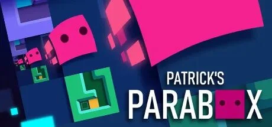
</figure>

### 修道院

这个区域是吹哥自述里教学最完整的区域，利用了各种环境里的缝隙与障碍物，非常容易吸引新玩家。

<figure>
  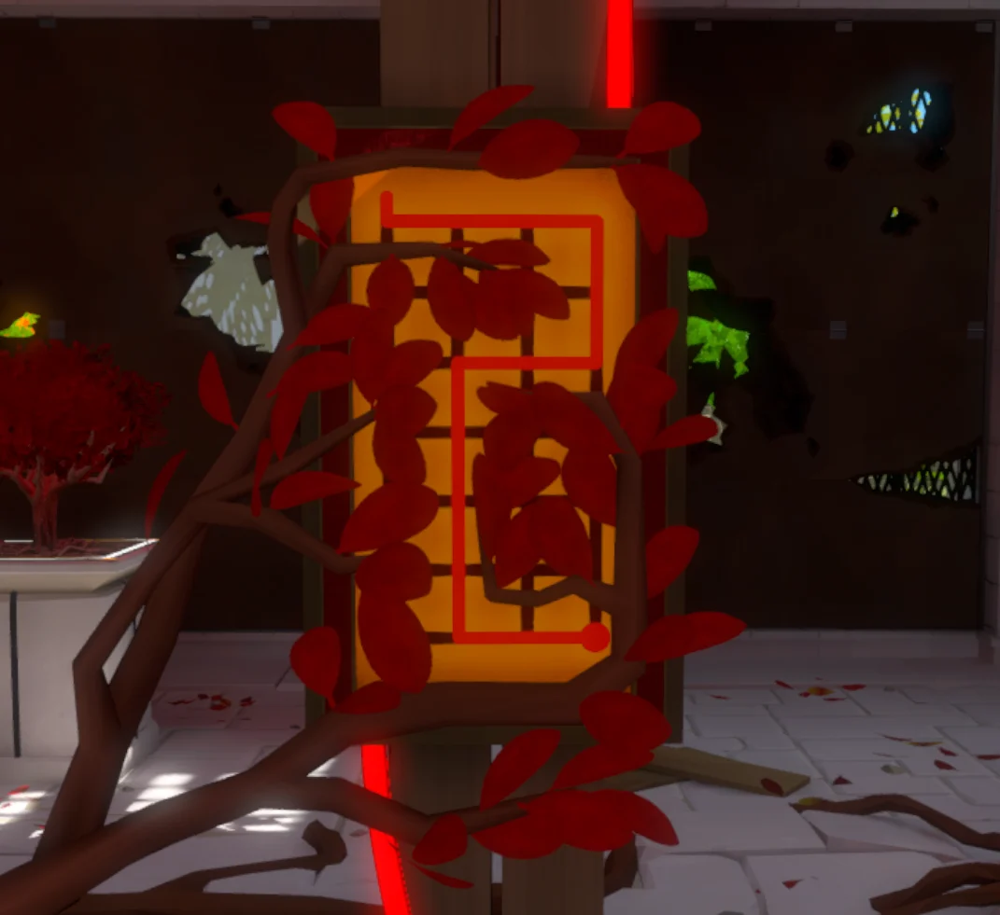
</figure>

<figure>
  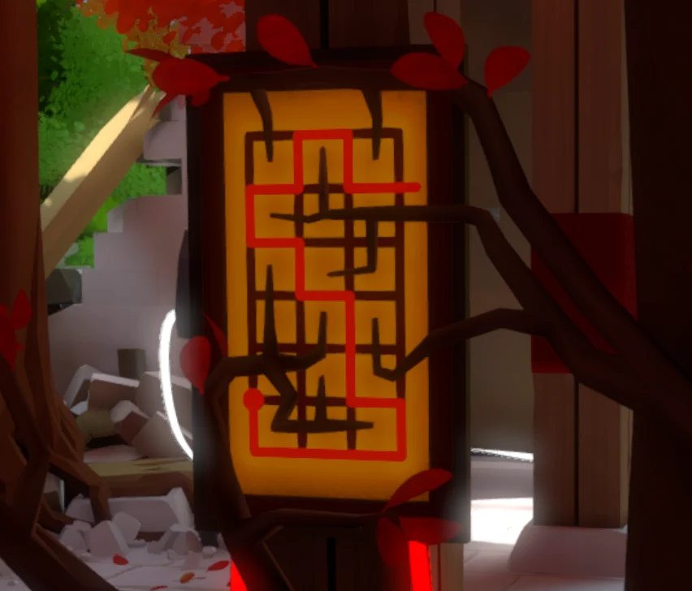
</figure>

但我是在完成许多其他区域后才来到这里的，反而有许多新鲜的体验。在我完全相信“每个谜题都会变换上一个谜题的思路”“答案一定在谜题身边”“吹哥的每一粒沙子都不会乱放”等结论后，这一片区域通过得异常顺利，像是在和一位值得信任的伙伴合作解谜。最后一个谜题需要将地上的断枝脑补到树上才可以看出答案，本身很跳出常规，但当我低头看到一个整整齐齐的阶梯型断枝后，又在屏幕前笑了起来。

“是不是太隐晦了。”

<figure>
  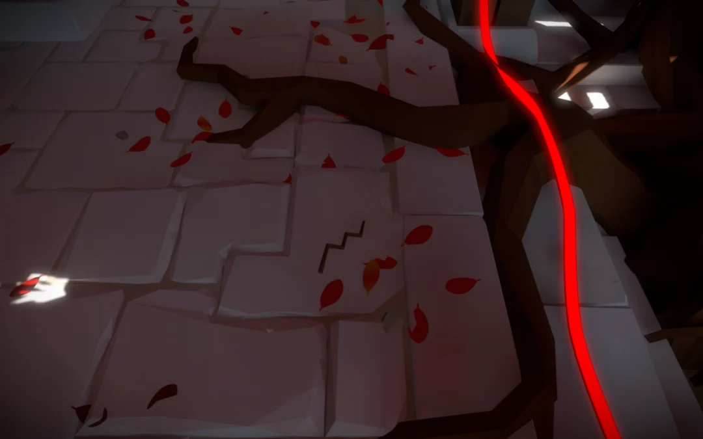
</figure>

### 城镇与山顶

为什么这两个区域放到一起说，因为它们都是“综合性测试”，只不过小镇是之前所有机制的叠加与组合，山顶作为最终区域，呈现了一些非常巨大的联动性解谜。学过数学竞赛的我给你打个比方：小镇类似于高联的一试，山顶类似二试（）

<figure>
  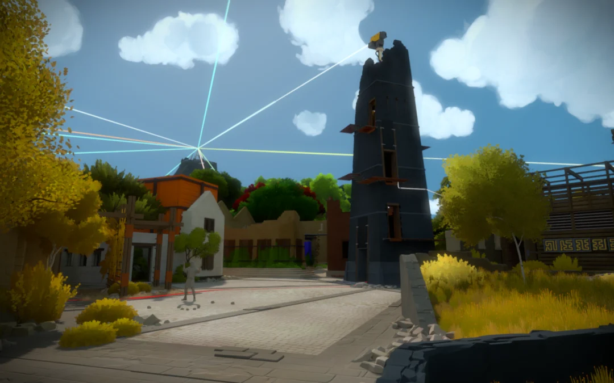
</figure>

完成这两个区域也让我在纸笔草稿以外动用了不少工具，诸如截图画板，甚至OBS和PR（真不是嘉豪，有几个色块随时间快速变化的谜题）。但完成过后依然很爽。有批评者说《见证者》的谜题没有奖励，我一直不是很理解，难道解谜游戏的奖励不应该就是解谜本身吗？

<figure>
  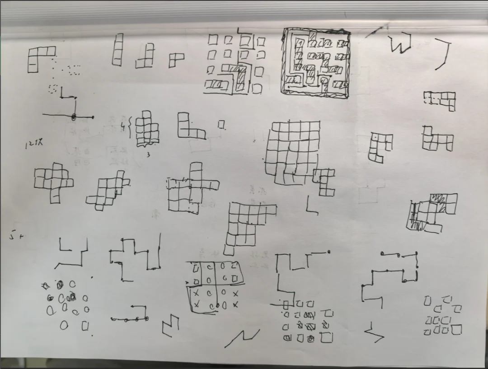
  <figcaption>涵盖的草稿</figcaption>
</figure>

## 四、统一性

这里的统一性体现在两个方面。其一是美术风格，我放几张风景图感受一下

<figure>
  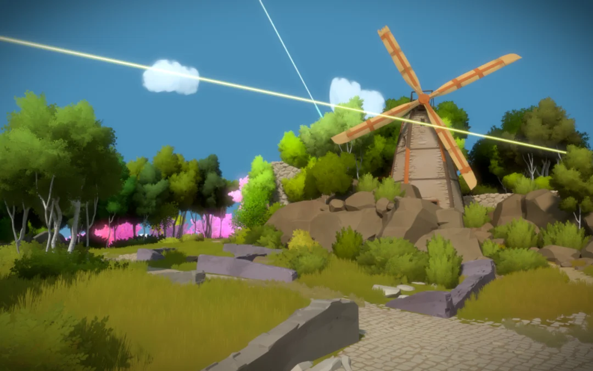
</figure>

<figure>
  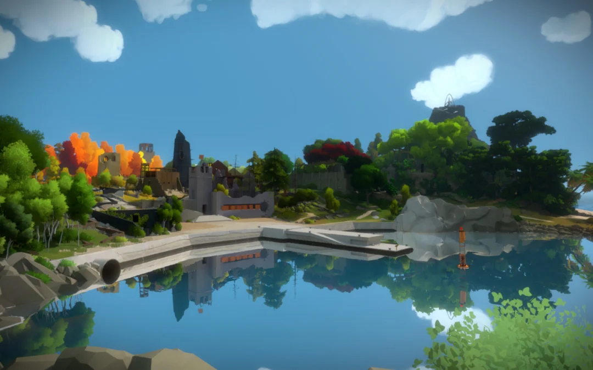
</figure>

吹哥原话是这样的：

> 「美术上的注意力守恒是风格的一部分。如果某个东西抓住了你的注意，它最好真的重要。……前几年我一直在训练美术：这看起来是很酷，但它不起作用，所以它不许这么酷。它不许抢戏，它得退到后面去。」

它是一种高对比、鲜艳但克制的画面，玩家被允许“看清”。

<figure>
  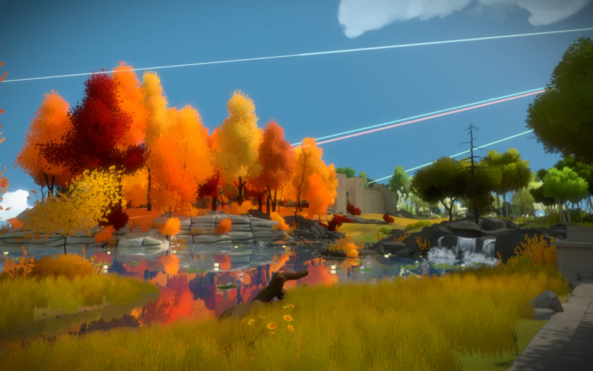
</figure>

其二是动作上的统一性，除了行走之外，游戏中唯一的互动方式就是和谜题一样的画线，坐电梯要画线，开船要画线，开门也要画线，用一种机制统一整个世界，其余元素全部排除，换来了强烈的可信感。

<figure>
  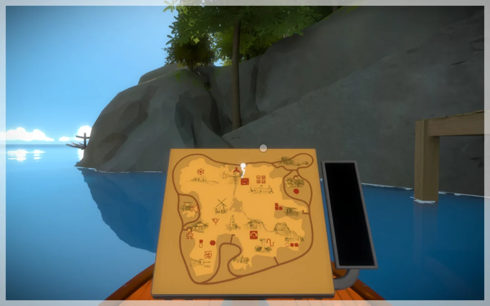
  <figcaption>在地图上画线来开船</figcaption>
</figure>

## 五、涵盖关于《Animal Well》的思考

流程中期，我在笔记里写下了一句“有点类银味道”，在我完全相信“吹哥的每一粒沙子都不会乱放”之后，又写下了一句“有点像《动物井》”。包括但不限于以下方面：

- 弱引导无文本的教学，玩法全靠作者的精心设计与玩家的想象力。
- 开放但不完全的开放世界，经典的类银地图锁与跳过（skip）：理论上你要学会谜题规则／道具用法才能进入新区域，但前者可以暴力破解一些谜题（非常不推荐这样做！！！），后者可以用一些奇妙的道具特性跳关（出名的悠悠球跳过大鸵鸟）。
- 《见证者》地图里每一棵树、每一粒沙子都有它存在的意义，《动物井》里地图的每一个空位都一定是一个空房间，完全相信作者之后便可以尽情思考／探索。

<figure>
  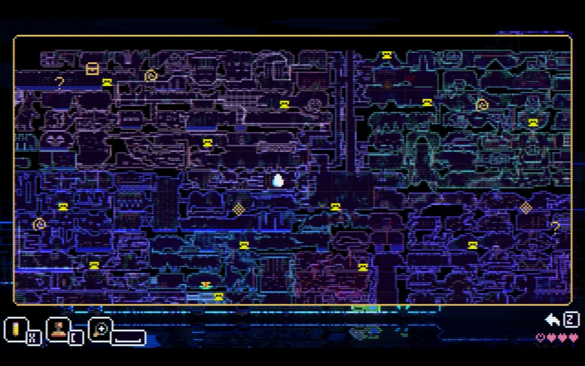
  <figcaption>动物井中铺满地图的房间</figcaption>
</figure>

- 通关不是终点，甚至才是起点：《见证者》的假结局仅需要完成正常谜题的7/11，就算是真结局完成11/11，也有135个环境谜题；《动物井》完成假结局一般来说只会收集到10个蛋左右，甚至连道具都没收集全，而真结局需要收集全部64个蛋和全部道具。
- 抽象且神秘的剧情、简单而纯净的操作方式……

<figure>
  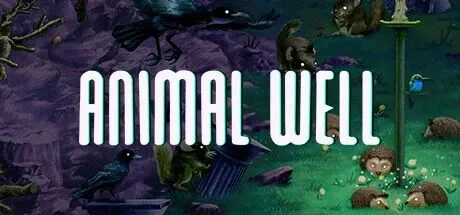
</figure>

巧合的是，尽管检索到的资料没有直接提及二者相似，但是在一篇文章里，作者用“MetroidBrainia”评价《动物井》，而这个词最初是独立游戏设计师 Nick Suttner 在2015年评论吹哥的《见证者》时最先提到的。MetroidBrainia 由 Metroidvania 派生而来，后者就是涵盖最爱玩的类银（类银河战士恶魔城），是两个游戏名的拼接：Metroid（任天堂的《银河战士》）＋Castlevania（科乐美的《恶魔城》）。而前者拆开就是 Metroid（银河战士）＋Brain（脑子）＋ia，翻译过来大概就是“银河脑游戏”。也算是对我的好奇有了一个答案。

## 结语

截稿时，我碰巧刷到了吹哥三天前发售的新作《沉星之序》（Order of the Sinking Star，2026年10月8日），更惊喜的是看到它与《动物井》和E胖新作 Mewgenics 在同一个捆绑包售卖。回到开头的话，或许热爱游戏的灵魂，无需沟通就能产生遥远的共鸣。吹哥花了七年，把 Myst 时代那套“到处乱点”的做法一条一条划掉。就像《时空幻境》一样，吹哥永远能带给行业惊喜，带给市场活力，以及带给每一份热爱游戏的玩家深深的感动。

<figure>
  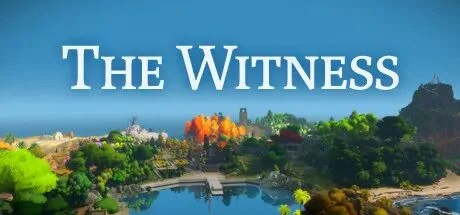
</figure>

## 参考资料

### 一、开发者访谈与原话

- [1] PlayStation.Blog《The Witness: Inside One of 2016's Most Important Games》（2015-09-21，Jonathan Blow 专访）
- [2] 中文设计剖析《再谈 The Witness——游戏设计剖析》（作者 GENTOVA，原载奶牛关）

### 二、类型与学术来源

- [3] Xin Pan & Wenting Chen. MetroidBrainias: The case of Animal Well. Proceedings of DiGRA 2025（扩展摘要）
- [4] Karppi, T., & Sotamaa, O. (2012). Rethinking Playing Research. Simulation & Gaming, 43(3), 413–429.

### 三、游戏本体与数据

- [5]《The Witness》Steam 商店页
- [6]《动物井 Animal Well》Steam 商店页
- [7]《沉星之序 Order of the Sinking Star》Steam 商店页
- [8] 区域与谜题数量（11 处激光区、7 道激光开启山顶终章、135 个环境谜题等）——玩家社群的攻略与统计，非官方数据。
